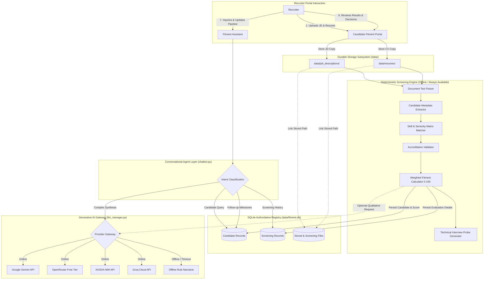

# 🧠 AI Architecture & Intelligence Ecosystem — Recruitment Intelligence Platform

## 1. Executive Assessment: Is This GenAI, Agentic AI, or Deterministic?

When evaluating modern AI recruiting software for executive leadership, technical review boards, or system audits, clarity of classification is critical.

The **Recruitment Intelligence Platform** is architected as an **Authoritative Deterministic Core with a Hybrid Generative and Agentic Intelligence Layer**.

It deliberately avoids trusting a pure GenAI model to calculate numerical scores or make compliance-critical hiring decisions. The exact classification of each system capability is detailed below:

```text
┌────────────────────────────────────────────────────────────────────────┐
│                   RECRUITMENT INTELLIGENCE PLATFORM                    │
├──────────────────────────┬──────────────────────┬──────────────────────┤
│  1. DETERMINISTIC CORE   │   2. GENERATIVE AI   │   3. AGENTIC AI      │
│     (Authoritative)      │    (Qualitative)     │  (Registry-Grounded) │
├──────────────────────────┼──────────────────────┼──────────────────────┤
│ • Document text parsing  │ • Qualitative        │ • Intent routing     │
│ • Candidate metadata     │   narrative summary  │ • Automated tool &   │
│   extraction (Regex)     │ • Nuanced skill-gap  │   SQL registry lookup│
│ • Keyword & semantic     │   observations       │ • Multi-turn state   │
│   competency mapping     │ • Executive persona  │   management         │
│ • Accreditations check   │   insights           │ • Validated status   │
│ • Mathematical scoring   │ • Contextual advice  │   update execution   │
│   (0–100 weighted scale) │                      │ • Global candidate   │
│ • Structured interview   │                      │   search & filtering │
│   probing questions      │                      │                      │
└──────────────────────────┴──────────────────────┴──────────────────────┘
```

---

### Detailed Capability Analysis

#### A. Deterministic Screening (Implemented & Authoritative)
- **Document Ingestion (`parser.py`)**: Sanitizes and extracts raw text from PDF, DOCX, DOC, and TXT files using `pypdf` and `python-docx` without relying on cloud OCR APIs.
- **Metadata Extraction (`deterministic_engine.py`)**: Extracts candidate name, email, normalized phone number, location, current organization, and designation via deterministic pattern matching and verified regex rules.
- **Competency & Seniority Analysis**: Matches skills against targeted industry dictionaries (networking, voice, cloud, cybersecurity, software engineering). Calculates years of experience and matches accreditations (CCNA, CCNP, CCIE, AWS, CISSP, CKA, PMP).
- **Mathematical Scoring Formula**:
  $$\text{Score} = w_{\text{skills}} \cdot S_{\text{skills}} + w_{\text{exp}} \cdot S_{\text{exp}} + w_{\text{edu}} \cdot S_{\text{edu}} + w_{\text{certs}} \cdot S_{\text{certs}}$$
  Executed purely in Python. The score is 100% reproducible and immune to model temperature, hallucination, or token drift.

#### B. Generative AI (Implemented as Optional Qualitative Layer)
- **Qualitative Assessment (`llm_manager.py`)**: When an LLM provider is connected, the platform passes the extracted JD requirements, candidate profile, and matched/missing evidence to generate a narrative executive summary.
- **Provider Transparency**: The portal clearly indicates whether an explanation was generated by Gemini, OpenRouter, NVIDIA NIM, or Groq, or if the offline fallback narrative was used.
- **Human-in-the-Loop Safeguard**: The LLM output is presented as supplementary advisory text. The numerical score and recommendation remain rooted in the deterministic results.

#### C. Agentic AI (Implemented Capabilities vs. Roadmap)

**What is implemented today:**
- **Intent Classification & Routing (`chatbot.py`)**: The Fitment Assistant classifies recruiter intents (candidate profile query, follow-up status check, candidate comparison, status change request, or interview probing) and routes the request to targeted data tools.
- **Database Tool Calling**: Dynamically queries the SQLite registry (`find_candidate_by_name`, `get_candidate_screenings`, `get_follow_ups_overview`, `update_candidate_status`).
- **Contextual State Memory**: Maintains active candidate focus across chat turns while allowing effortless portal-wide candidate pivoting.
- **Action Execution with Validation**: Directly executes status transitions in SQLite upon explicit recruiter request while enforcing the 11 valid recruitment statuses.

**What is planned for future phases (Not yet autonomous):**
- **Autonomous Multi-Step Hiring Actions**: Automatically emailing candidates or scheduling calendar invitations without human confirmation (intentionally withheld for recruiter governance).
- **Autonomous Candidate Sourcing**: Web scraping external candidate databases or LinkedIn without user input.

---

## 2. AI Ecosystem & Ingestion Flow Diagram



---

## 3. End-to-End Request Lifecycle

1. **Upload & Durable Persistence**:
   - The recruiter uploads a Job Description and Candidate Resume (.pdf, .docx, or .txt).
   - `storage.py` computes the SHA-256 digest of each file and writes the pristine original bytes to `data/job_descriptions/` and `data/resumes/` under collision-safe filenames.
   - Initial file metadata is recorded in the SQLite candidate registry.
2. **Text Ingestion & Validation**:
   - `parser.py` extracts text from the stored files.
   - If a file is corrupted or empty, descriptive validation errors are returned immediately.
3. **Deterministic Evaluation**:
   - `deterministic_engine.py` extracts candidate identity, contact number, email, and designation.
   - It cross-references skills detected in the resume against role mandates, calculates depth of experience, checks certifications, and derives the weighted fitment score (0–100).
4. **Authoritative Registration**:
   - The candidate profile is upserted into the SQLite registry.
   - The screening record is created, and the source file references are linked via the `screening_files` junction table.
5. **Qualitative Narrative Synthesis (Optional)**:
   - If an external AI provider is configured and verified, a structured prompt containing the deterministic evidence is sent to the LLM.
   - The model generates qualitative candidate strengths, observations, and recommendations.
   - If the request times out (exceeding 35 seconds) or fails, the application automatically falls back to offline assessment without interrupting the screening report.
6. **Recruiter Review & Lifecycle Transition**:
   - The recruiter reviews the side-by-side results, verified badges, and interview probing questions.
   - The recruiter can update the recruitment stage (e.g. `Shortlisted` or `Interview Scheduled`), which writes an immutable audit record to `candidate_status_history`.
7. **Conversational Exploration**:
   - The recruiter can ask the Fitment Assistant questions about any registered candidate, screening event, or follow-up deadline.
   - The Assistant executes parameterized SQL queries and provides copyable plain-text responses.

---

## 4. Multi-Provider Management & Fallback Governance

The platform incorporates a robust, fault-tolerant provider management layer in `llm_manager.py`:

| Provider | Supported Models | Verification Mechanism | Fallback Policy |
| :--- | :--- | :--- | :--- |
| **Google Gemini** | `gemini-3.5-flash-lite`<br/>`gemini-2.5-flash`<br/>`gemini-2.5-pro` | Direct ping to `https://generativelanguage.googleapis.com` with API key. | Falls back to OpenRouter if configured, then NVIDIA NIM, then Offline. |
| **OpenRouter** | `google/gemma-4-26b-a4b-it:free`<br/>`nvidia/nemotron-3.5-lightning:free` | Connectivity probe to `https://openrouter.ai/api/v1/models`. | Evaluates free-tier catalog; falls back to offline on rate limits. |
| **NVIDIA NIM** | `stepfun-ai/step-5-preview`<br/>`z-ai/glm-5.3`<br/>`meta/llama-3.1-70b-instruct` | Probe to `https://integrate.api.nvidia.com/v1/models`. | Falls back to offline screening on timeout. |
| **Groq Cloud** | `llama-3.3-70b-versatile`<br/>`llama-3.1-8b-instant` | Probe to `https://api.groq.com/openai/v1/models`. | Fast fallback to offline if API limit reached. |
| **InstantFit Offline** | Pure Deterministic Engine | None required (Runs 100% locally). | **Base authoritative layer** for all portal evaluations. |

### Technical Reliability Rules:
- **No False Positive Connection Badges**: A provider is only marked `Connected` after an active connectivity probe returns HTTP 200 within an 8-second budget. If keys are present but unverified, it displays `Configured`.
- **Strict Execution Timeouts**: Qualitative LLM generation calls have a maximum timeout of 35 seconds to prevent browser hangs.
- **Zero Hallucination of Database Facts**: The Fitment Assistant retrieves facts (mobile numbers, scores, dates) directly from SQLite; the LLM is never permitted to invent candidate data.
