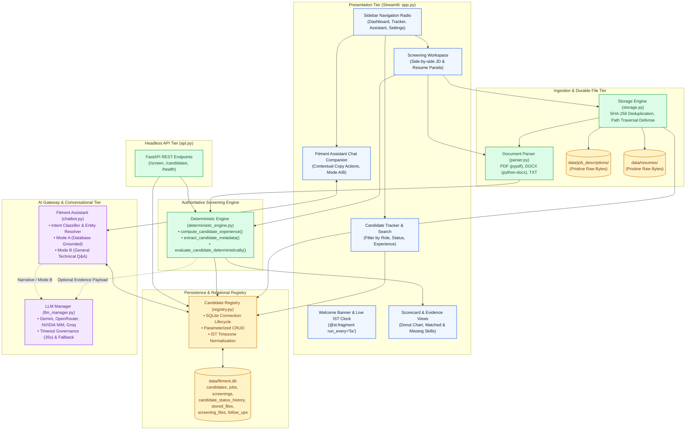

# 🏛️ Application Architecture — FITMENT.AI Recruitment Intelligence Platform

> **Audience**: Software Engineers, Solution Architects, Technical Leads, and System Maintainers.  
> **Last Reviewed**: 2026-10-19  
> **Primary Source Code**: [`app.py`](file:///e:/Projects/resume-screening-agent/app.py), [`deterministic_engine.py`](file:///e:/Projects/resume-screening-agent/deterministic_engine.py), [`registry.py`](file:///e:/Projects/resume-screening-agent/registry.py), [`storage.py`](file:///e:/Projects/resume-screening-agent/storage.py), [`chatbot.py`](file:///e:/Projects/resume-screening-agent/chatbot.py), [`llm_manager.py`](file:///e:/Projects/resume-screening-agent/llm_manager.py), [`parser.py`](file:///e:/Projects/resume-screening-agent/parser.py), [`api.py`](file:///e:/Projects/resume-screening-agent/api.py).

---

## 1. Executive Architecture Summary

**FITMENT.AI** is an enterprise talent acquisition decision-support system built with a modular Python architecture. It features a responsive Streamlit presentation tier, an authoritative offline-capable deterministic scoring core, a relational SQLite persistence layer, and a multi-provider generative AI narrative gateway.

The platform is designed around three fundamental design invariants:
1. **Zero-Hallucination Authority**: Numerical scoring (0–100), skill matching, seniority detection, and accreditation validation are computed deterministically using mathematical weights and regex tokenization in Python. They are never delegated to probabilistic LLM token generators.
2. **Database-Grounded Intelligence**: Candidate identities, evaluation history, and recruitment pipeline stages reside in SQLite (`data/fitment.db`), which serves as the authoritative source of truth.
3. **Graceful Offline Continuity**: 100% of core screening workflows, candidate lookups, and reporting operate without network access or cloud API dependencies.

---

## 2. Comprehensive Component Diagram

---

## 3. Detailed Component Catalog

### 3.1 Presentation Orchestrator ([`app.py`](file:///e:/Projects/resume-screening-agent/app.py))

- **Purpose**: Implements the user-facing Streamlit application, sidebar configuration, dynamic light theme styling, state transitions, and responsive layout.
- **Key Functions**:
  - `render_welcome_banner()`: Renders the personalized welcome message, today's recruitment KPI counts (Screened, Shortlisted, Interview, Joined) in IST, and the live clock pill.
  - `@st.fragment(run_every="5s") def _live_clock_fragment()`: Isolates the live clock ticker to avoid full-page Streamlit re-renders.
  - `render_copy_actions(content, key_suffix)`: Generates client-side JavaScript copy-to-clipboard buttons.
  - `render_donut_chart(score)`: Produces a high-contrast SVG circular fitment gauge.
  - Main navigation dispatcher (`chosen_nav` routing between Dashboard, Candidate Tracker, Fitment Assistant, and Settings).
- **Session State Dependencies**:
  - `st.session_state.pending_nav`: Defers navigation target to prevent `StreamlitWidgetAlreadyInstantiatedError`.
  - `st.session_state.selected_nav`: Holds active top-level view.
  - `st.session_state.tracker_reset_filters`: Triggers search filter clearing when navigating via "View All".
  - `st.session_state.active_candidate_id` / `active_screening_record`: Focus state for candidate details.
- **Error Handling**: Displays non-blocking notification banners (`st.warning`, `st.error`) and logs exceptions to console.

### 3.2 Authoritative Screening Engine ([`deterministic_engine.py`](file:///e:/Projects/resume-screening-agent/deterministic_engine.py))

- **Purpose**: Computes mathematical candidate-job alignment, extracts entity profiles, identifies skill overlaps and gaps, and generates targeted interview probes.
- **Key Functions**:
  - `compute_candidate_experience(resume_text)`: Evaluates seniority using regex across three priority tiers (explicit labels, natural prose, and timeline intervals) while filtering academic graduation dates.
  - `extract_candidate_metadata(resume_text)`: Deterministically parses candidate name, mobile phone number, email address, location, current organization, and job title.
  - `detect_certifications(resume_text)`: Verifies vendor accreditations (Cisco CCNA/CCNP/CCIE, AWS, Azure, GCP, Kubernetes CKA/CKAD, CISSP, PMP) against normalized pattern dictionaries.
  - `evaluate_candidate_deterministically(jd_text, cv_text, weights)`: The primary screening pipeline returning score (0–100), verdict (`Strong Fit`, `Moderate Fit`, `Weak Fit`), matched skills, missing skills, evidence snippets, and interview probes.
- **Design Invariants**: Zero external network calls; 100% reproducible execution.

### 3.3 Relational Registry & Persistence ([`registry.py`](file:///e:/Projects/resume-screening-agent/registry.py))

- **Purpose**: Controls database schema initialization, transaction handling, timezone parsing, and parameterized CRUD operations for SQLite (`data/fitment.db`).
- **Key Functions**:
  - `init_db(db_path)`: Creates 7 tables (`candidates`, `jobs`, `screenings`, `candidate_status_history`, `follow_ups`, `stored_files`, `screening_files`), indexes, and runs safe schema migrations.
  - `upsert_candidate(...)`: Inserts or updates candidate records while preserving historical creation timestamps.
  - `save_screening(...)`: Persists full evaluation payloads including JSON-serialized skills, evidence, and scores.
  - `get_dashboard_analytics_summary(db_path)`: Computes calendar-day activity counts in `Asia/Kolkata` (IST) using boundary queries `[ist_start, ist_end)` alongside all-time aggregates.
  - `format_last_screened(timestamp_str)`: Normalizes ISO timestamps to human-readable format: `DD Mon YYYY, HH:MM:SS IST`.
- **Concurrency & Safety**: Context manager `get_connection()` enables `PRAGMA foreign_keys = ON;` and `sqlite3.Row` factory. All queries use parameterized SQL (`?`).

### 3.4 Durable File Storage Engine ([`storage.py`](file:///e:/Projects/resume-screening-agent/storage.py))

- **Purpose**: Manages persistent file storage under `data/job_descriptions/` and `data/resumes/` with security validation and deduplication.
- **Key Functions**:
  - `save_job_description_file(file_bytes, filename, ...)`: Computes SHA-256 digest, checks for existing duplicate, writes to temporary file, and atomic renames to avoid partial-write corruption.
  - `save_resume_file(file_bytes, filename, ...)`: Generates collision-safe filenames and registers file metadata in SQLite.
  - `resolve_stored_path(raw_path, base_dir)`: Enforces path-traversal validation via `os.path.commonpath`.
  - `read_stored_file_bytes(file_ref, base_dir)`: Safely loads raw file bytes for parsing or export.

### 3.5 Document Parsing Service ([`parser.py`](file:///e:/Projects/resume-screening-agent/parser.py))

- **Purpose**: Extracts clean plain text from PDF, DOCX, and TXT files.
- **Key Functions**:
  - `extract_text_from_pdf(file_source, min_characters)`: Reads PDF chunks via `pypdf.PdfReader`, decrypts blank-password files, and cleans whitespace.
  - `extract_text_from_docx(file_source, min_characters)`: Iterates paragraphs and table cells via `python-docx`.
  - `extract_text_from_txt(file_source, min_characters)`: Decodes UTF-8 text with replacement fallback.
  - `extract_text_from_file(file_source, filename)`: Universal router based on file extension.
- **Custom Exceptions**: `DocumentProcessingError`, `PDFParsingError`, `EmptyDocumentError`.

### 3.6 Fitment Assistant & Chatbot Router ([`chatbot.py`](file:///e:/Projects/resume-screening-agent/chatbot.py))

- **Purpose**: Multi-turn recruitment assistant supporting candidate registry queries (Mode A) and general technical Q&A (Mode B).
- **Key Functions**:
  - `FitmentAssistant.ask(user_query, selected_candidate_id, ...)`:
    - Defense against secret leakage: Intercepts queries seeking API keys, database URLs, or system passwords.
    - Intent 1: Candidate status transitions (e.g. "Move Tarun to Shortlisted").
    - Intent 2: Global portal queries (candidate lists, follow-up overviews, top candidates).
    - Intent 3: Candidate-specific queries (score, contact, skills, experience, interview probes).
    - Mode B: Routes non-candidate general technical inquiries to `llm_manager.generate_general_assistant_response()`.

### 3.7 AI Provider Gateway ([`llm_manager.py`](file:///e:/Projects/resume-screening-agent/llm_manager.py))

- **Purpose**: Centralized multi-provider gateway managing connections, model catalogs, timeouts, and offline fallback.
- **Supported Providers**:
  - **Google Gemini**: Models `gemini-3.5-flash-lite`, `gemini-2.5-flash`, `gemini-2.5-pro`.
  - **OpenRouter**: Models `google/gemma-4-26b-a4b-it:free`, `nvidia/nemotron-3.5-lightning:free`.
  - **NVIDIA NIM**: Models `stepfun-ai/step-5-preview`, `z-ai/glm-5.3`, `meta/llama-3.1-70b-instruct`.
  - **Groq Cloud**: Model `llama-3.3-70b-versatile`.
- **Resilience Policy**: Strict 35-second socket timeout (`DEFAULT_TIMEOUT = 35.0`). If a cloud provider times out or returns HTTP 429/500, execution falls back automatically to offline rule narratives without raising uncaught exceptions.

### 3.8 Headless REST API ([`api.py`](file:///e:/Projects/resume-screening-agent/api.py))

- **Purpose**: Optional FastAPI service providing automated headless screening endpoints for external HRIS or pipeline integrations.
- **Endpoints**:
  - `POST /screen`: Accepts JSON job description and resume text, returns structured scoring response.
  - `POST /screen/upload`: Accepts multipart/form-data PDF/DOCX files.
  - `GET /candidates`: Lists registered candidates from SQLite.
  - `GET /health`: Returns service health status.

---

## 4. Cross-Module Data Contracts

| Originating Module | Receiving Module | Data Contract / Structure | Purpose |
| :--- | :--- | :--- | :--- |
| `storage.py` | `parser.py` | `bytes`, `filename: str` | Raw document bytes passed for text extraction. |
| `parser.py` | `deterministic_engine.py` | `cleaned_text: str` | Sanitized plaintext passed for keyword and seniority parsing. |
| `deterministic_engine.py` | `registry.py` | `det_result: Dict[str, Any]` | Dictionary of candidate profile, scores, skills, and questions persisted to DB. |
| `deterministic_engine.py` | `llm_manager.py` | `evidence_dict: Dict[str, Any]` | Grounded deterministic results provided as context for LLM narrative synthesis. |
| `registry.py` | `chatbot.py` | `sqlite3.Row` / `Dict[str, Any]` | Ground truth candidate profile and screening records for conversational answers. |
| `llm_manager.py` | `app.py` / `chatbot.py` | `{"status": str, "text": str, "provider": str}` | Qualitative synthesis and general technical explanations. |

---

## 5. Security & Isolation Boundaries

1. **Process Isolation**: The Streamlit portal runs in an isolated Python process. REST API endpoints in `api.py` run on a distinct port (8000) via Uvicorn.
2. **Path Containment**: Storage access is strictly locked to `./data` via canonical path comparison.
3. **In-Memory Credential Safety**: LLM API keys are kept in volatile memory or local `.env`; never persisted in the SQLite database.
4. **Widget Session Guarding**: Streamlit widget state modifications use safe deferred flag patterns (`st.session_state.pending_nav`) to guarantee zero instantiation lifecycle errors.
