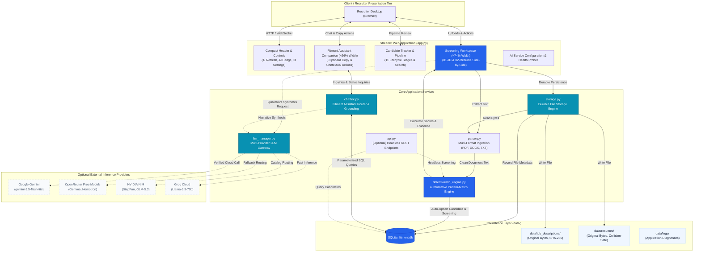
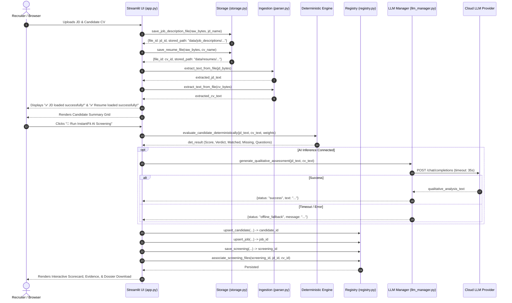
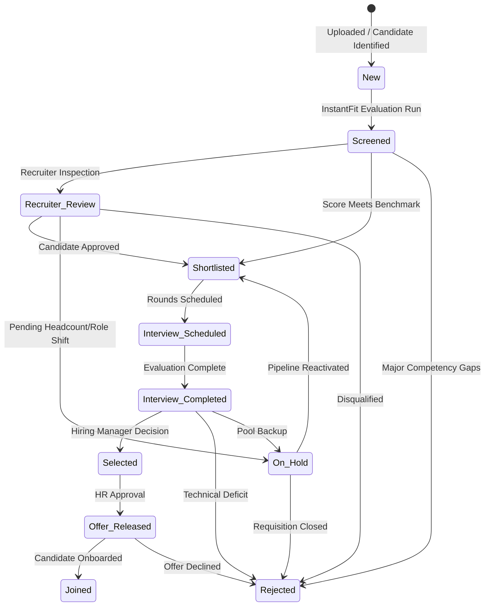

# 🏛️ Solution Architecture — Recruitment Intelligence Platform

## 1. Executive Summary & Architectural Scope

The **Recruitment Intelligence Platform** is an enterprise talent acquisition decision-support system. It delivers deterministic, zero-hallucination screening calculations for candidate CVs against target Job Descriptions, combined with qualitative generative AI summaries and a conversational recruitment intelligence assistant.

The core architecture is anchored around three foundational principles:
1. **Authoritative Determinism**: Scoring calculations, skill alignments, and seniority detections are calculated via verifiable regex, token matching, and set-theory algorithms in Python rather than non-deterministic LLM tokens.
2. **Local Registry Grounding**: The SQLite candidate registry is the source of truth for candidate identities, contact numbers, screening histories, and follow-up timelines.
3. **Resilient Offline Continuity**: Complete screening and retrieval workflows operate seamlessly without cloud connectivity or active LLM endpoints.

---

## 2. End-to-End System Context & Architecture Diagram

---

## 3. Component Responsibilities & Module Catalog

| Module | Architectural Role | Key Responsibilities | Dependencies |
| :--- | :--- | :--- | :--- |
| **`app.py`** | Presentation Orchestrator | Streamlit UI layout, responsive grid cards, header controls, top-right refresh action, candidate summary strip, scorecard display, right companion panel, and dossier export. | `streamlit`, `storage`, `registry`, `deterministic_engine`, `llm_manager`, `chatbot` |
| **`storage.py`** | Storage Abstraction | Enforces file persistence under `data/job_descriptions/` and `data/resumes/`. Manages collision-safe unique filenames, SHA-256 deduplication, path-traversal prevention, and byte reading. | `hashlib`, `os`, `re`, `shutil`, `registry` |
| **`parser.py`** | Document Ingestion | Safely reads PDF, DOCX, DOC, and TXT files. Sanitizes control characters, strips formatting noise, and extracts raw textual tokens. | `pypdf`, `docx` (`python-docx`) |
| **`deterministic_engine.py`** | Authoritative Evaluation | Extracts candidate metadata (name, mobile, email, organization, designation, experience). Computes exact skill overlap, gap analysis, experience scoring, certification verification, and weighted score synthesis. | `re`, `math` |
| **`registry.py`** | Data Persistence & Schema | Manages SQLite connection lifecycle, parameterized queries, candidate upserts, screening associations, `stored_files` and `screening_files` junction rows, recruitment status audit trail, and follow-up scheduling. | `sqlite3`, `contextlib` |
| **`chatbot.py`** | Intent Routing & Grounding | Parses natural-language recruiter questions, classifies intent (candidate lookup, follow-up check, comparison, status update, interview questions), queries registry, and formats verified markdown responses. | `registry`, `llm_manager` |
| **`llm_manager.py`** | AI Provider Gateway | Manages external AI providers (Gemini, OpenRouter, NVIDIA NIM, Groq). Handles API key resolution, connection timeout budgets, and offline fallback. | `urllib.request`, `json`, `os` |
| **`api.py`** | Headless API Service | Optional FastAPI application providing REST endpoints (`/screen`, `/candidates`, `/health`) for headless orchestration. | `fastapi`, `pydantic`, `registry`, `deterministic_engine` |

---

## 4. Screening Execution Flow

---

## 5. Candidate Data & Screening History Model

The SQLite database (`data/fitment.db`) enforces relational integrity through parameterized queries:

### Primary Tables
1. **`candidates`**:
   - `candidate_id` (TEXT, PK): 8-character UUID.
   - `name`, `email`, `mobile`, `location`: Candidate identifiers.
   - `current_organization`, `current_designation`, `total_experience`, `relevant_experience`.
   - `certifications` (TEXT): JSON array of detected certifications.
   - `current_status` (TEXT): Default `'Screened'`.
   - `created_at`, `updated_at`: ISO-8601 timestamps.

2. **`jobs`**:
   - `job_id` (TEXT, PK), `job_title`, `job_description`, `required_skills` (JSON).

3. **`screenings`**:
   - `screening_id` (TEXT, PK): UUID.
   - `candidate_id` (FK -> `candidates`), `job_id` (FK -> `jobs`).
   - `deterministic_score` (INT 0-100), `verdict` (TEXT), `recommendation` (TEXT).
   - `skills_score`, `exp_score`, `cert_score`.
   - `matched_skills` (JSON), `missing_skills` (JSON), `supporting_evidence` (JSON).
   - `interview_questions` (JSON).
   - `llm_analysis` (TEXT), `llm_provider` (TEXT), `llm_model` (TEXT).
   - `screening_timestamp` (TEXT).

4. **`stored_files`**:
   - `file_id` (TEXT, PK), `file_type` (`'job_description'` | `'resume'`).
   - `original_filename`, `stored_relative_path`, `file_size`, `sha256_hash`, `upload_timestamp`.
   - `candidate_id` (FK), `job_id` (FK), `screening_id` (TEXT).

5. **`screening_files` (Junction Table)**:
   - `id` (INTEGER PK AUTOINCREMENT), `screening_id` (FK), `file_id` (FK), `file_role` (`'jd'` | `'resume'`), `created_at`.
   - *Design Note*: Enables many-to-many relationships (e.g. one JD reused across multiple candidate screenings).

6. **`candidate_status_history`**:
   - `id` (PK), `candidate_id` (FK), `screening_id`, `previous_status`, `new_status`, `changed_at`, `notes`, `changed_by`.

7. **`follow_ups`**:
   - `id` (PK), `candidate_id` (FK), `follow_up_date`, `status` (`'pending'` | `'completed'`), `notes`.

---

## 6. Recruitment Status Lifecycle

Every transition writes an immutable audit record in `candidate_status_history`.

---

## 7. Fitment Assistant Conversational Execution

The Fitment Assistant (`chatbot.py`) functions as a domain-specialized conversational agent:

1. **Context Resolution**: Checks whether an active candidate is selected (`active_candidate_id`) or if the user's message mentions a registered candidate's name.
2. **Intent Classification**:
   - **Candidate Lookup**: Factual queries about designation, experience, contact details, or fitment score.
   - **Follow-up Inquiries**: Queries about upcoming, overdue, or due-today candidate milestones.
   - **Screening Comparisons**: Chronological evaluation events across multiple screenings.
   - **Interview Probe Requests**: Role-specific technical probing questions.
   - **Status Transitions**: Modifying candidate hiring status.
3. **Database Grounding**: Executes parameterized SQL queries against `registry.py` to fetch verified ground truth.
4. **Response Formatting**: Formats plain-text markdown summaries with highlights, bullets, and scorecards.
5. **Client-Side Copy Actions**: Emits plain-text payload for the `📋 Copy Response` client-side clipboard button.

---

## 8. Security Boundaries & Design Safeguards

- **No Remote Code Execution**: Document parsers exclusively extract text strings; no active scripts, macros, or executables are evaluated.
- **Path Traversal Defense**: `storage.py` resolves canonical paths and verifies `os.path.commonpath([base_dir, resolved]) == base_dir` before writing or reading.
- **Data Protection**: Uploaded candidate files, SQLite database, and logs are segregated into `data/` and excluded from Git commits via `.gitignore`.
- **Zero API Key Leakage**: API credentials reside in local `.env` or password-masked Streamlit widgets; keys are never stored in database tables or logs.
- **SQL Parameterization**: All database transactions use SQLite `?` placeholders, eliminating SQL injection risks.

---

## 9. Comprehensive Architecture Vault & Specialized Guides

For specialized architectural topics, refer to the following companion guides:

- [**Application Architecture (`APPLICATION_ARCHITECTURE.md`)**](file:///e:/Projects/resume-screening-agent/APPLICATION_ARCHITECTURE.md) — Detailed tier breakdown, data contracts, and component interfaces.
- [**Data Architecture (`DATA_ARCHITECTURE.md`)**](file:///e:/Projects/resume-screening-agent/DATA_ARCHITECTURE.md) — SQLite schema, ER model, storage engine, and IST timezone boundary queries.
- [**AI Architecture (`AI_ARCHITECTURE.md`)**](file:///e:/Projects/resume-screening-agent/AI_ARCHITECTURE.md) — AI taxonomy, deterministic scoring formulas, and provider integrations.
- [**Security Policy (`SECURITY.md`)**](file:///e:/Projects/resume-screening-agent/SECURITY.md) — STRIDE threat model, secrets governance, and PII protection.
- [**Documentation Vault (`docs/README.md`)**](file:///e:/Projects/resume-screening-agent/docs/README.md) — Master index of all 33+ specialized technical guides across Architecture, AI, Data & Security, Learning, and Operations.

