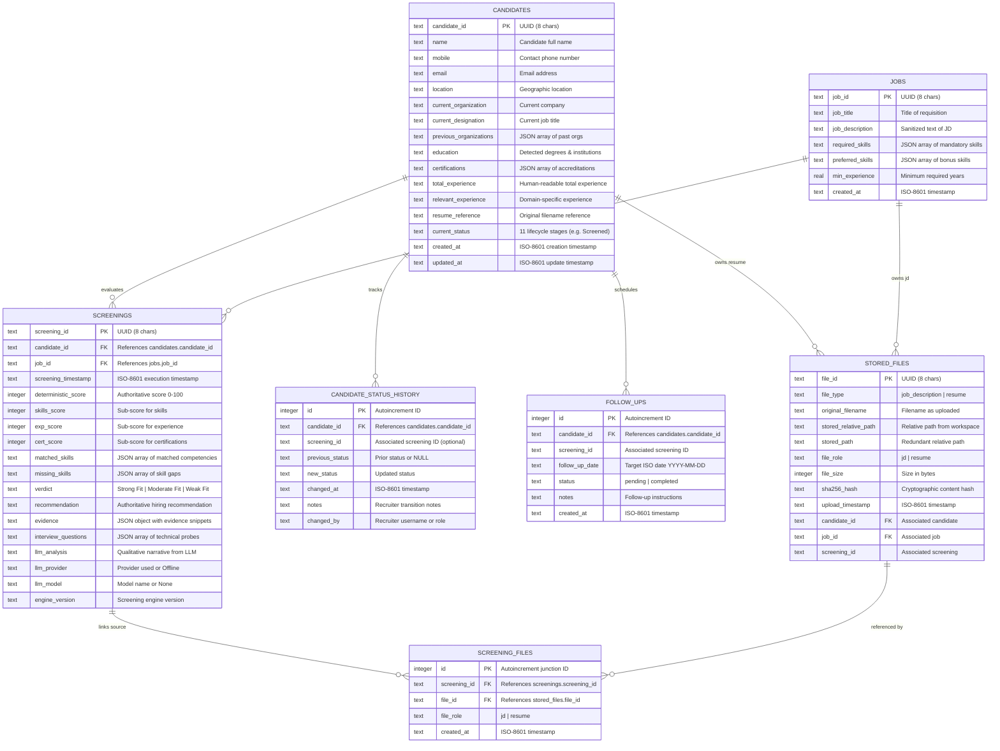

# 💾 Data Architecture — FITMENT.AI Recruitment Intelligence Platform

> **Audience**: Database Administrators, Backend Engineers, Solution Architects, and Compliance Officers.  
> **Last Reviewed**: 2026-10-19  
> **Primary Source Code**: [`registry.py`](file:///e:/Projects/resume-screening-agent/registry.py), [`storage.py`](file:///e:/Projects/resume-screening-agent/storage.py).

---

## 1. Data Layer Overview

**FITMENT.AI** utilizes an embedded relational database model paired with a local content-addressable filesystem. The data tier operates entirely on-premise or within the local host environment, requiring no external managed database instances (such as Amazon RDS or Cloud SQL).

The primary storage assets are:
1. **Relational Registry (`data/fitment.db`)**: An SQLite 3 database enforcing foreign key constraints (`PRAGMA foreign_keys = ON;`), relational indexing, and transactional integrity.
2. **Durable File Store (`data/`)**: Partitioned disk storage for original uploaded job descriptions (`data/job_descriptions/`) and candidate resumes (`data/resumes/`).
3. **Audit Log Store (`data/logs/`)**: Application diagnostic logs and runtime traces.

---

## 2. Entity-Relationship Model



---

## 3. Relational Schema & Table Specifications

The database schema is defined in [`registry.py`](file:///e:/Projects/resume-screening-agent/registry.py) within the `init_db()` function.

### 3.1 `candidates` Table
Stores unique candidate entities. Primary candidate matching is resolved against `name`, `mobile`, and `email`.
- **Primary Key**: `candidate_id` (`TEXT`)
- **Indexes**:
  - `idx_candidates_name` on `name`
  - `idx_candidates_email` on `email`
  - `idx_candidates_mobile` on `mobile`
  - `idx_candidates_status` on `current_status`
  - `idx_candidates_org` on `current_organization`
  - `idx_candidates_desig` on `current_designation`

### 3.2 `jobs` Table
Stores target job descriptions and extracted role parameters.
- **Primary Key**: `job_id` (`TEXT`)
- **Indexes**:
  - `idx_jobs_title` on `job_title`

### 3.3 `screenings` Table
Stores historical screening evaluation runs. Each evaluation represents an immutable assessment snapshot of a candidate against a job description.
- **Primary Key**: `screening_id` (`TEXT`)
- **Foreign Keys**:
  - `candidate_id` -> `candidates(candidate_id)` ON DELETE CASCADE
  - `job_id` -> `jobs(job_id)` ON DELETE CASCADE
- **Indexes**:
  - `idx_screenings_candidate` on `candidate_id`
  - `idx_screenings_job` on `job_id`
  - `idx_screenings_score` on `deterministic_score`

### 3.4 `stored_files` Table
Catalogs persisted physical files on disk. Tracks original file metadata, deduplication hashes, and file roles.
- **Primary Key**: `file_id` (`TEXT`)
- **Unique Invariant**: Deduplication via `sha256_hash`. If an identical file is uploaded, the existing `stored_files` row is reused rather than writing duplicate bytes to disk.

### 3.5 `screening_files` (Junction Table)
Represents the many-to-many relationship between screening events and stored files.
- **Primary Key**: `id` (`INTEGER AUTOINCREMENT`)
- **Foreign Keys**:
  - `screening_id` -> `screenings(screening_id)` ON DELETE CASCADE
  - `file_id` -> `stored_files(file_id)` ON DELETE CASCADE
- **Design Rationale**: A single Job Description file may be screened against 50 different candidate resumes. This junction table enables many candidate screenings to link to the same master JD file without redundant duplication.

### 3.6 `candidate_status_history` Table
An immutable chronological audit log tracking every stage transition across the 11 recruitment lifecycle stages.
- **Primary Key**: `id` (`INTEGER AUTOINCREMENT`)
- **Foreign Keys**:
  - `candidate_id` -> `candidates(candidate_id)` ON DELETE CASCADE

### 3.7 `follow_ups` Table
Recruiter task and milestone reminders associated with specific candidates.
- **Primary Key**: `id` (`INTEGER AUTOINCREMENT`)
- **Foreign Keys**:
  - `candidate_id` -> `candidates(candidate_id)` ON DELETE CASCADE

---

## 4. Date & Timezone Architecture (IST Alignment)

All timestamps generated by FITMENT.AI are recorded in ISO-8601 format. The platform explicitly standardizes recruitment activity and daily analytics to **Indian Standard Time (IST, UTC+05:30)** using Python's `zoneinfo.ZoneInfo("Asia/Kolkata")`.

### Calendar-Day Boundary Logic

Daily metrics in the Welcome Banner (Screened, Shortlisted, Interview, Joined) evaluate the active calendar day in IST:
1. `ist_now = datetime.now(ZoneInfo("Asia/Kolkata"))`
2. `ist_start = ist_now.replace(hour=0, minute=0, second=0, microsecond=0)`
3. `ist_end = ist_start + timedelta(days=1)`
4. `utc_start = ist_start.astimezone(ZoneInfo("UTC"))`
5. `utc_end = ist_end.astimezone(ZoneInfo("UTC"))`

In SQLite queries, timestamps are filtered using parameterized query boundaries:
```sql
(
    (col NOT LIKE '%Z' AND col NOT LIKE '%+00:00' AND col >= ? AND col < ?)
    OR
    ((col LIKE '%Z' OR col LIKE '%+00:00') AND col >= ? AND col < ?)
)
```
This dual-range pattern correctly evaluates naive local IST strings, aware `+05:30` strings, and UTC `Z` strings across midnight boundaries without deleting or modifying past database records.

---

## 5. Storage Engine & File Lifecycle

The file persistence engine ([`storage.py`](file:///e:/Projects/resume-screening-agent/storage.py)) manages physical file lifecycles:

```text
[Incoming Streamlit UploadedFile]
               │
               ▼
   [Compute SHA-256 Digest]
               │
       ┌───────┴───────┐
       ▼               ▼
[Hash Exists in DB?]   [New File Content]
       │               │
       │ (Reuse ID)    ├─ Write to temp file (tempfile.mkstemp)
       │               ├─ Atomic rename to destination path
       │               └─ Record file metadata in 'stored_files'
       ▼               ▼
   [Link to 'screening_files' Junction Table]
```

### Path Sanitization & Collision Safety
- Filenames on disk are normalized: `cv_{candidate_clean_name}_{short_hash}{ext}` or `jd_{clean_title}_{short_hash}{ext}`.
- Path traversal is blocked using `os.path.commonpath([base_directory, target_path]) == base_directory`.
- Deletion operations (`delete_saved_resume`, `delete_saved_job_description`) remove the disk file and cascade-clean junction records.

---

## 6. Backup, Recovery & Retention

### Online Backup Procedure
Because SQLite supports atomic reads, hot backups can be taken while Streamlit is actively running:
```powershell
$timestamp = Get-Date -Format "yyyyMMdd_HHmmss"
Copy-Item data/fitment.db "data/fitment_backup_$timestamp.db"
```

### Full Disaster Recovery
1. Stop the Streamlit process.
2. Restore `fitment.db` from the desired backup snapshot.
3. Verify file integrity under `data/job_descriptions/` and `data/resumes/`.
4. Restart Streamlit: `streamlit run app.py`.

### Retention & Pruning
Candidate evaluation history in `screenings` and `candidate_status_history` is permanent by default. Physical CV files older than corporate retention policies (e.g. 180 days) can be archived or deleted using `storage.delete_stored_file(file_id)` without corrupting the candidate profile or screening scorecard.
