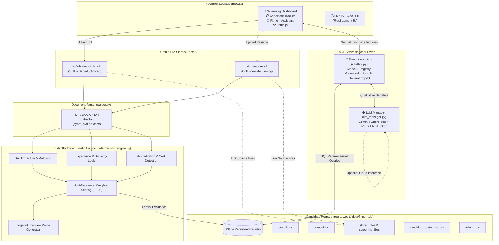

# 🎯 FITMENT.AI — Recruitment Intelligence Platform
### Candidate Fitment Screening Portal | AI-Assisted Recruitment Intelligence

[](https://www.python.org/)
[](https://streamlit.io/)
[](https://www.sqlite.org/)
[](LICENSE)
[]()

The **FITMENT.AI Recruitment Intelligence Platform** is an enterprise-grade candidate fitment screening and recruitment pipeline management portal. Designed for talent acquisition teams, technical recruiters, and hiring managers, the platform combines **authoritative deterministic evaluation** (zero-hallucination skill mapping, experience scoring, and accreditation verification) with **optional generative AI qualitative synthesis** and a conversational **Fitment Assistant** grounded in persistent candidate records.

---

## 🏛️ High-Level System Architecture



---

## 📚 Technical Knowledge Base & Documentation Vault

The repository includes a comprehensive, verified engineering knowledge base for developers, solution architects, and talent acquisition leaders:

| Knowledge Domain | Authority Document | Focus Topics |
| :--- | :--- | :--- |
| **System Architecture** | [**ARCHITECTURE.md**](file:///e:/Projects/resume-screening-agent/ARCHITECTURE.md) | High-level solution design, component interactions, and execution models. |
| **Application Architecture** | [**APPLICATION_ARCHITECTURE.md**](file:///e:/Projects/resume-screening-agent/APPLICATION_ARCHITECTURE.md) | Presentation orchestrator, data contracts, state management, and component breakdown. |
| **AI Architecture & Taxonomy**| [**AI_ARCHITECTURE.md**](file:///e:/Projects/resume-screening-agent/AI_ARCHITECTURE.md) | Deterministic vs. GenAI vs. Agentic AI classification and multi-provider gateway. |
| **Data Architecture & Schema** | [**DATA_ARCHITECTURE.md**](file:///e:/Projects/resume-screening-agent/DATA_ARCHITECTURE.md) | SQLite relational schema, ER diagrams, storage engine, and IST timezone standard. |
| **Security & Privacy** | [**SECURITY.md**](file:///e:/Projects/resume-screening-agent/SECURITY.md) | STRIDE threat model, secrets governance, and PII protections. |
| **Contributing Guidelines** | [**CONTRIBUTING.md**](file:///e:/Projects/resume-screening-agent/CONTRIBUTING.md) | Developer guidelines, code style, pre-commit checklists, and quality gates. |
| **Release Changelog** | [**CHANGELOG.md**](file:///e:/Projects/resume-screening-agent/CHANGELOG.md) | Version history and release notes. |
| **Master Documentation Vault**| [**docs/README.md**](file:///e:/Projects/resume-screening-agent/docs/README.md) | Master directory linking all 33+ specialized technical documents. |

### Specialized Deep-Dive Vaults (`docs/`)
- [**docs/architecture/**](file:///e:/Projects/resume-screening-agent/docs/architecture/): [System Context](file:///e:/Projects/resume-screening-agent/docs/architecture/system-context.md), [Components](file:///e:/Projects/resume-screening-agent/docs/architecture/application-components.md), [Data Flow](file:///e:/Projects/resume-screening-agent/docs/architecture/data-flow.md), [Sequence Diagrams](file:///e:/Projects/resume-screening-agent/docs/architecture/sequence-diagrams.md), [State Management](file:///e:/Projects/resume-screening-agent/docs/architecture/state-management.md), [Error Handling](file:///e:/Projects/resume-screening-agent/docs/architecture/error-handling.md), [Deployment](file:///e:/Projects/resume-screening-agent/docs/architecture/deployment-architecture.md), [ADR Decisions](file:///e:/Projects/resume-screening-agent/docs/architecture/architecture-decisions.md).
- [**docs/ai/**](file:///e:/Projects/resume-screening-agent/docs/ai/): [AI Ecosystem](file:///e:/Projects/resume-screening-agent/docs/ai/ai-ecosystem.md), [Deterministic vs. GenAI](file:///e:/Projects/resume-screening-agent/docs/ai/deterministic-vs-genai.md), [Chatbot Modes](file:///e:/Projects/resume-screening-agent/docs/ai/chatbot-modes.md), [Grounding & Retrieval](file:///e:/Projects/resume-screening-agent/docs/ai/grounding-and-retrieval.md), [Provider Integration](file:///e:/Projects/resume-screening-agent/docs/ai/provider-integration.md), [Agentic Assessment](file:///e:/Projects/resume-screening-agent/docs/ai/agentic-ai-assessment.md), [AI Evaluation](file:///e:/Projects/resume-screening-agent/docs/ai/ai-evaluation.md).
- [**docs/data-and-security/**](file:///e:/Projects/resume-screening-agent/docs/data-and-security/): [Database Schema](file:///e:/Projects/resume-screening-agent/docs/data-and-security/database-schema.md), [Entity Relationships](file:///e:/Projects/resume-screening-agent/docs/data-and-security/entity-relationships.md), [Data Lifecycle](file:///e:/Projects/resume-screening-agent/docs/data-and-security/data-lifecycle.md), [Privacy & Threat Model](file:///e:/Projects/resume-screening-agent/docs/data-and-security/privacy-and-threat-model.md), [Secrets Reference](file:///e:/Projects/resume-screening-agent/docs/data-and-security/secrets-and-configuration.md).
- [**docs/learning/**](file:///e:/Projects/resume-screening-agent/docs/learning/): [Knowledge Map](file:///e:/Projects/resume-screening-agent/docs/learning/KNOWLEDGE_MAP.md), [Mental Models](file:///e:/Projects/resume-screening-agent/docs/learning/MENTAL_MODELS.md), [End-to-End Walkthrough](file:///e:/Projects/resume-screening-agent/docs/learning/END_TO_END_WALKTHROUGH.md), [Codebase Tour](file:///e:/Projects/resume-screening-agent/docs/learning/CODEBASE_TOUR.md), [Glossary](file:///e:/Projects/resume-screening-agent/docs/learning/GLOSSARY.md), [Architecture Q&A](file:///e:/Projects/resume-screening-agent/docs/learning/ARCHITECTURE_QA.md), [Exercises](file:///e:/Projects/resume-screening-agent/docs/learning/EXERCISES.md).
- [**docs/operations/**](file:///e:/Projects/resume-screening-agent/docs/operations/): [Setup & Install](file:///e:/Projects/resume-screening-agent/docs/operations/setup-and-installation.md), [Configuration](file:///e:/Projects/resume-screening-agent/docs/operations/configuration-reference.md), [Testing Guide](file:///e:/Projects/resume-screening-agent/docs/operations/testing-guide.md), [Troubleshooting](file:///e:/Projects/resume-screening-agent/docs/operations/troubleshooting.md), [Backup & Recovery](file:///e:/Projects/resume-screening-agent/docs/operations/backup-and-recovery.md), [Release Workflow](file:///e:/Projects/resume-screening-agent/docs/operations/release-and-github-workflow.md).

---

## ✨ Key Platform Capabilities

1. **Space-Efficient Enterprise Light Theme**:
   - Modern, high-contrast palette (`#F3F6FC` canvas, `#FFFFFF` panels, `#2563EB` primary accents, `#172033` deep slate typography).
   - Compact header containing branding, subtitle, verified AI connectivity badge, and a top-right `↻ Refresh Page` action.
   - 74% main screening workspace paired with a 26% dedicated right-side **Fitment Assistant** companion.

2. **Live IST Clock & Date-Aware Daily Analytics**:
   - Integrated live clock pill in Welcome Banner displaying `DD Mon YYYY, HH:MM:SS IST (UTC+05:30)`.
   - Real-time updates isolated via `@st.fragment(run_every="5s")` without full-page re-renders.
   - Recomputes Screened, Shortlisted, Interview, and Joined counts for the active calendar day in `Asia/Kolkata` using parameterized boundary queries without deleting historical data.

3. **Candidate Last-Screened Timestamps in IST**:
   - Standardized `Last screened: DD Mon YYYY, HH:MM:SS IST` (or `Not screened yet`) rendered consistently across Candidate Summary, Full Profile Dialog, Candidate Tracker, and Recently Viewed cards.

4. **InstantFit Deterministic Screening Engine**:
   - **Zero-hallucination math**: Candidate scores (0–100) are calculated mathematically from verified pattern matching, role tenure regexes, and accreditation dictionaries.
   - **Immediate Offline Screening**: Fully functional offline without external API keys or cloud dependencies.

5. **Durable File Storage (`data/` Directory)**:
   - Stored in `data/job_descriptions/` and `data/resumes/`.
   - SHA-256 deduplication, collision-safe filenames, and directory traversal protections.
   - Many-to-many `screening_files` junction table enables reusing a single JD across multiple candidate evaluations.

6. **Candidate Pipeline & Status Lifecycle**:
   - Tracks 11 hiring stages: `New`, `Screened`, `Shortlisted`, `Recruiter Review`, `Interview Scheduled`, `Interview Completed`, `On Hold`, `Rejected`, `Selected`, `Offer Released`, `Joined`.
   - Complete immutable audit trail in `candidate_status_history` logging timestamps, recruiter notes, and previous statuses.

7. **Portal-Wide Fitment Assistant**:
   - Dual-mode architecture: Database-grounded candidate intelligence (Mode A) and general technical copilot (Mode B).
   - Instant client-side **`📋 Copy Response`** button beneath every message with contextual quick-copy actions:
     - `📄 Copy Candidate Details`
     - `🎯 Copy Fitment Summary`
     - `🎤 Copy Interview Questions`

8. **Flexible Multi-Provider AI Ecosystem**:
   - **Google Gemini**: `gemini-3.5-flash-lite`, `gemini-2.5-flash`, `gemini-2.5-pro`
   - **OpenRouter (Free Catalog)**: `google/gemma-4-26b-a4b-it:free`, `nvidia/nemotron-3.5-lightning:free`
   - **NVIDIA NIM**: `stepfun-ai/step-5-preview`, `z-ai/glm-5.3`, `meta/llama-3.1-70b-instruct`
   - **Groq Cloud**: `llama-3.3-70b-versatile`
   - **InstantFit Offline Fallback**: Deterministic analysis when external services time out (>35s) or are offline.

---

## 📂 Repository Structure

```text
resume-screening-agent/
├── app.py                         # Enterprise Streamlit application portal
├── deterministic_engine.py        # Authoritative deterministic evaluation engine
├── registry.py                    # SQLite candidate registry, lifecycle, & IST analytics
├── storage.py                     # Secure durable file persistence engine (data/)
├── chatbot.py                     # Fitment Assistant intent routing & database grounding
├── llm_manager.py                 # Multi-provider LLM gateway with timeout & fallback
├── parser.py                      # Multi-format document parser (PDF, DOCX, TXT)
├── api.py                         # Optional FastAPI REST endpoints
├── agent_engine.py                # Standalone multi-agent pipeline
├── mcp_server.py                  # FastMCP tool server
├── requirements.txt               # Pinned Python production dependencies
├── .env.example                   # Sanitized configuration template
├── .gitignore                     # Git privacy protections for candidate data & secrets
├── .streamlit/
│   └── config.toml                # Light theme and server configuration
├── data/                          # Persistent storage root (protected by .gitignore)
│   ├── fitment.db                 # SQLite database file
│   ├── job_descriptions/          # Stored job descriptions (.docx, .pdf, .txt)
│   ├── resumes/                   # Stored candidate CVs (.docx, .pdf, .txt)
│   └── logs/                      # Runtime application logs
├── docs/                          # Architecture Knowledge Base & Learning Vault
│   ├── README.md                  # Master documentation index
│   ├── architecture/              # 8 architectural specifications & ADRs
│   ├── ai/                        # 7 AI ecosystem, evaluation, & grounding guides
│   ├── data-and-security/         # 5 database schema, ER, & security documents
│   ├── learning/                  # 7 training tracks, mental models, & tour guides
│   └── operations/                # 6 runbooks, setup, testing, & release guides
├── tests/                         # Automated unit & regression test suites (155 tests)
├── ARCHITECTURE.md                # Solution architecture & component interaction guide
├── APPLICATION_ARCHITECTURE.md    # In-depth application tiers & data contracts
├── AI_ARCHITECTURE.md             # AI taxonomy, evaluation, & multi-provider gateway
├── DATA_ARCHITECTURE.md           # Relational schema, ER model, & storage architecture
├── SECURITY.md                    # Data privacy, STRIDE threat model, & secrets governance
├── CONTRIBUTING.md                # Developer contribution guide & quality gates
└── CHANGELOG.md                   # Release notes & version history
```

---

## 🚀 Quickstart & Setup

### Prerequisites
- Python 3.10, 3.11, or 3.12 (64-bit)
- Git

### 1. Clone the Repository
```bash
git clone https://github.com/tarun1-github/Resume-Screening.git
cd Resume-Screening
```

### 2. Set Up Virtual Environment
```bash
# Windows (PowerShell)
python -m venv .venv
.\.venv\Scripts\Activate.ps1

# Linux / macOS
python3 -m venv .venv
source .venv/bin/activate
```

### 3. Install Dependencies
```bash
pip install --upgrade pip
pip install -r requirements.txt
```

### 4. Configure Environment (Optional)
Copy the sanitized template:
```bash
copy .env.example .env     # Windows
cp .env.example .env       # Linux/macOS
```
*(Note: The platform functions 100% reliably in Offline Mode without any API keys. Keys can also be entered in the application's sidebar Settings.)*

### 5. Launch the Portal
```bash
streamlit run app.py
```
Open your browser at `http://localhost:8501`.

---

## 🧪 Automated Testing & Verification

Run the complete automated test suite (**155 unit and integration tests**):

```bash
python -m unittest discover tests
```

Expected output:
```text
Ran 155 tests in ~28s
OK
```

---

## 🔒 Security & Privacy Notice
- Candidate resumes and job descriptions uploaded through the portal are stored locally in the project's `data/` directory and are **strictly excluded from Git tracking** via `.gitignore`.
- API keys entered in the interface are masked (`type="password"`) and held only in volatile session memory.
- All database queries use parameterized SQL (`?`) to prevent SQL injection vulnerabilities.

---

## 📄 License
This project is licensed under the [MIT License](LICENSE).