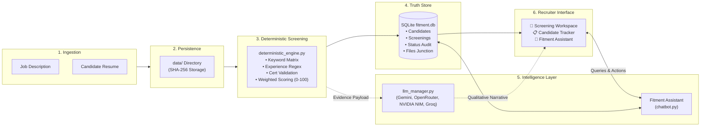

# 🌐 Recruitment Intelligence Platform — AI Ecosystem Executive Guide

> **Audience**: Talent Acquisition Leadership, Solution Architects, Technical Hiring Managers, and AI Governance Committees.  
> **Note**: For the modular, expanded AI knowledge base, visit [**docs/ai/**](file:///e:/Projects/resume-screening-agent/docs/ai/ai-ecosystem.md) and the [**Master Documentation Index**](file:///e:/Projects/resume-screening-agent/docs/README.md).

---

## 1. Executive Summary & AI Classification

A common dilemma in modern recruitment technology is whether an AI tool is **Generative AI**, **Agentic AI**, or **Deterministic Automation**.

The **Recruitment Intelligence Platform** is deliberately designed with a **Three-Pillar Hybrid Architecture**:

```text
┌────────────────────────────────────────────────────────────────────────┐
│                   RECRUITMENT INTELLIGENCE PLATFORM                    │
├────────────────────────────────────────────────────────────────────────┤
│  1. Authoritative Deterministic Engine (Math, Regex, Zero Hallucination)│
│  2. Grounded Agentic Assistant (Intent Routing, Registry Tool Calling) │
│  3. Advisory Generative AI Layer (Narrative Synthesis, Multi-Provider) │
└────────────────────────────────────────────────────────────────────────┘
```

### Why Not Pure Generative AI?
Large Language Models (LLMs) are probabilistic token predictors. When applied directly to compliance-heavy hiring decisions, they suffer from:
- **Temperature & Token Drift**: The same resume evaluated twice against the same JD may receive different scores.
- **Hallucinated Accreditations**: Models may assume a candidate holds a CISSP or CCIE because they mentioned a related concept.
- **Black-Box Opacity**: Calculating compensation bands or shortlisting candidates without explainable numerical weighting exposes enterprises to legal risk.

**Our Solution**: The platform uses **Python-based deterministic algorithms** to calculate scores (0–100), extract metadata, and identify skill gaps. Generative AI is reserved for **qualitative narrative explanations**, while the **Fitment Assistant** acts as a grounded conversational agent against the local SQLite database.

---

## 2. System Architecture Diagram



---

## 3. Real-World Walkthrough: Typical Screening Request

```text
[Recruiter Uploads Files]
       │
       ▼
[Durable Storage (storage.py)]
       ├─ Validates file extension (.pdf, .docx, .txt) & 15 MB limit.
       ├─ Computes SHA-256 digest (prevents duplicate storage bloat).
       └─ Writes original bytes safely to data/job_descriptions/ and data/resumes/.
       │
       ▼
[Deterministic Analysis (deterministic_engine.py)]
       ├─ Extracts candidate contact details (Name, Mobile, Email, Location).
       ├─ Matches skills against technical role requirements.
       ├─ Detects total and relevant years of experience.
       ├─ Identifies industry accreditations (CCNA, CCNP, AWS, CKA, CISSP, etc.).
       └─ Calculates weighted score (0–100) and compiles structured interview probes.
       │
       ▼
[Database Registration (registry.py)]
       ├─ Upserts candidate profile in 'candidates' table.
       ├─ Saves screening event in 'screenings' table.
       └─ Links source files in 'screening_files' junction table.
       │
       ▼
[Qualitative AI Narrative (llm_manager.py) - Optional]
       ├─ Checks active AI provider connection (Gemini, OpenRouter, NVIDIA, or Groq).
       ├─ Transmits deterministic evidence to the model.
       ├─ Receives nuanced qualitative strengths and gap observations.
       └─ Automatically falls back to offline assessment if provider times out (>35s).
       │
       ▼
[Recruiter Decision & Pipeline Management (app.py)]
       ├─ Recruiter reviews scorecard, evidence pills, and interview questions.
       ├─ Recruiter updates status (e.g. 'Shortlisted' or 'Interview Scheduled').
       ├─ Status change is written to 'candidate_status_history' audit timeline.
       └─ One-click export of Candidate Fitment Dossier (.md).
```

---

## 4. Real-World Walkthrough: Fitment Assistant Conversational Flow

The Fitment Assistant functions as a **database-grounded AI agent**:

1. **Recruiter Query**: `"What is Tarun's fitment score and is his contact number available?"`
2. **Intent & Entity Routing**:
   - Classifies query as **Candidate Lookup**.
   - Resolves target candidate entity: `Tarun`.
3. **Database Tool Execution**:
   - Calls `registry.find_candidate_by_name("Tarun")`.
   - Calls `registry.get_candidate_screenings(candidate_id)`.
4. **Grounded Synthesis**:
   - Retrieves verified facts: Score `85/100`, Role `Voice L3 Lead`, Mobile `+91-9876543210`.
   - Formats a clear, structured markdown response.
5. **Instant Client-Side Copying**:
   - Renders a **`📋 Copy Response`** button below the message.
   - Automatically provides contextual buttons: `📄 Copy Candidate Details` and `🎯 Copy Fitment Summary`.
   - The recruiter copies the verified details directly into their ATS or email without manual text selection.

---

## 5. Offline Continuity & Model Fallback Matrix

| State | Status Display | Functionality |
| :--- | :--- | :--- |
| **Cloud Provider Connected** | `🟢 AI Service: Connected` | Complete deterministic scoring + LLM-generated qualitative narrative. |
| **API Key Missing or Expired** | `⚡ InstantFit Offline Screening` | 100% of numerical scores, skill matching, interview probes, and registry queries function offline. |
| **Cloud Provider Timeout (>35s)** | `⚠️ AI Service: Fallback Used` | Instant switch to deterministic qualitative assessment with zero user disruption. |

---

## 6. Current Capabilities vs. Planned Roadmap

| Capability | Current Status | Architecture Approach |
| :--- | :--- | :--- |
| **Deterministic Skill & Experience Matching** | ✅ Implemented | Verifiable Python regex and set theory. |
| **Durable Storage with Deduplication** | ✅ Implemented | SHA-256 hash indexing under `data/`. |
| **11-Stage Candidate Status Lifecycle** | ✅ Implemented | SQLite database with immutable transition history. |
| **Grounded Fitment Assistant** | ✅ Implemented | Parameterized SQL query tools + intent router. |
| **One-Click Clipboard Copying** | ✅ Implemented | Client-side JavaScript with plain-text formatting. |
| **Multi-Provider LLM Gateway** | ✅ Implemented | Gemini, OpenRouter, NVIDIA NIM, Groq. |
| **Automated ATS Webhook Sync** | ⏳ Roadmap | Scheduled for Phase 2 REST API expansion. |
| **Autonomous Candidate Sourcing** | ⏳ Roadmap | Planned for agentic sourcing integration. |
