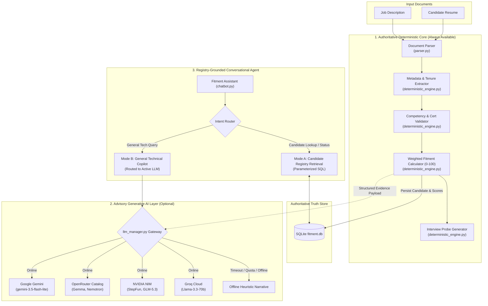

# 🧠 AI Ecosystem — FITMENT.AI Recruitment Intelligence Platform

> **Audience**: AI Engineers, Solution Architects, Technical Evaluators, and Hiring Committees.  
> **Last Reviewed**: 2026-10-19  
> **Primary Source Code**: [`deterministic_engine.py`](file:///e:/Projects/resume-screening-agent/deterministic_engine.py), [`llm_manager.py`](file:///e:/Projects/resume-screening-agent/llm_manager.py), [`chatbot.py`](file:///e:/Projects/resume-screening-agent/chatbot.py).

---

## 1. Executive AI Classification: The Three-Pillar Model

In recruitment technology, marketing claims frequently conflate deterministic algorithms, generative language models, and autonomous agents under the generic label "AI".

**FITMENT.AI** enforces clear architectural segregation through a **Three-Pillar Hybrid Model**:

```text
┌─────────────────────────────────────────────────────────────────────────────┐
│                      FITMENT.AI INTELLIGENCE ECOSYSTEM                      │
├──────────────────────────┬──────────────────────────┬───────────────────────┤
│  1. DETERMINISTIC CORE   │   2. GENERATIVE AI       │   3. AGENTIC AI       │
│     (Authoritative)      │      (Qualitative)       │  (Registry-Grounded)  │
├──────────────────────────┼──────────────────────────┼───────────────────────┤
│ • Document text parsing  │ • Qualitative narrative  │ • Intent parsing &    │
│ • Candidate metadata     │   strengths & gaps       │   routing             │
│   extraction (Regex)     │ • Nuanced executive      │ • Parameterized SQL   │
│ • Keyword & semantic     │   observations           │   database lookups    │
│   competency mapping     │ • Advisory commentary    │ • Multi-turn context  │
│ • Accreditations check   │ • Multi-provider gateway │   state tracking      │
│ • Mathematical scoring   │   (Gemini, OpenRouter,   │ • Recruitment status  │
│   (0–100 weighted formula)│  NVIDIA NIM, Groq)      │   transitions         │
│ • Structured interview   │ • Offline heuristic      │ • Secret shielding    │
│   probing questions      │   fallbacks              │   security barrier    │
└──────────────────────────┴──────────────────────────┴───────────────────────┘
```

---

## 2. Capability Matrix Across Pillars

| Platform Capability | Underlying Technique | Authoritative or Advisory? | Offline Capable? | Source Code Module |
| :--- | :--- | :--- | :--- | :--- |
| **Document Ingestion** | PDF chunk parsing (`pypdf`), DOCX paragraph iteration (`python-docx`), text sanitization. | **Authoritative** | Yes | [`parser.py`](file:///e:/Projects/resume-screening-agent/parser.py) |
| **Candidate Identity Extraction** | Regex pattern matching for Name, Mobile (E.164), Email, Location, Company, Title. | **Authoritative** | Yes | [`deterministic_engine.py`](file:///e:/Projects/resume-screening-agent/deterministic_engine.py) |
| **Experience Tenure Detection** | Multi-tier regex analyzing explicit labels, prose expressions, and timeline intervals with academic date filtering. | **Authoritative** | Yes | [`deterministic_engine.py`](file:///e:/Projects/resume-screening-agent/deterministic_engine.py) |
| **Accreditation Verification** | Dictionaries of vendor certifications (Cisco, AWS, Azure, GCP, Kubernetes, (ISC)², PMI). | **Authoritative** | Yes | [`deterministic_engine.py`](file:///e:/Projects/resume-screening-agent/deterministic_engine.py) |
| **Fitment Score Synthesis** | Multi-parameter weighted formula: $0.30\cdot S_{\text{skills}} + 0.40\cdot S_{\text{exp}} + 0.15\cdot S_{\text{edu}} + 0.15\cdot S_{\text{certs}}$. | **Authoritative** | Yes | [`deterministic_engine.py`](file:///e:/Projects/resume-screening-agent/deterministic_engine.py) |
| **Interview Probing Questions** | Rule-based generation targeted to identified missing skills and domain gaps. | **Authoritative** | Yes | [`deterministic_engine.py`](file:///e:/Projects/resume-screening-agent/deterministic_engine.py) |
| **Qualitative Synthesis** | Few-shot prompted LLM narrative describing candidate strengths, nuances, and executive advice. | **Advisory** | Fallback Available | [`llm_manager.py`](file:///e:/Projects/resume-screening-agent/llm_manager.py) |
| **Candidate Data Retrieval** | Parameterized SQL queries against SQLite registry (`candidates`, `screenings`, `follow_ups`). | **Authoritative** | Yes | [`chatbot.py`](file:///e:/Projects/resume-screening-agent/chatbot.py), [`registry.py`](file:///e:/Projects/resume-screening-agent/registry.py) |
| **Status Update Execution** | Validated state machine transitions against 11 recruitment lifecycle stages. | **Authoritative** | Yes | [`chatbot.py`](file:///e:/Projects/resume-screening-agent/chatbot.py), [`registry.py`](file:///e:/Projects/resume-screening-agent/registry.py) |
| **General Technical Copilot** | Prompt routed to active LLM provider for generic engineering questions. | **Advisory** | No | [`chatbot.py`](file:///e:/Projects/resume-screening-agent/chatbot.py), [`llm_manager.py`](file:///e:/Projects/resume-screening-agent/llm_manager.py) |

---

## 3. High-Level AI Architecture Diagram



---

## 4. Why This Hybrid Architecture Outperforms Pure LLM Screening

1. **Zero Temperature Drift**: If the same candidate resume is screened against the same job description 100 times, the deterministic score will be identical every single time. Pure LLM evaluators produce fluctuating scores across runs.
2. **Zero Hallucinated Credentials**: An LLM might assume a candidate has an AWS Solution Architect certification simply because they worked on EC2 instances. The deterministic engine requires explicit pattern verification.
3. **Auditability & Legal Compliance**: Every point in the 0–100 score is tied to verified sentence-level evidence snippets in the candidate's CV, ensuring defensible hiring decisions.
4. **Resilient Cost & Quota Economics**: The primary screening workload incurs zero token consumption, preserving LLM API quotas for high-value qualitative synthesis and conversational assistance.
