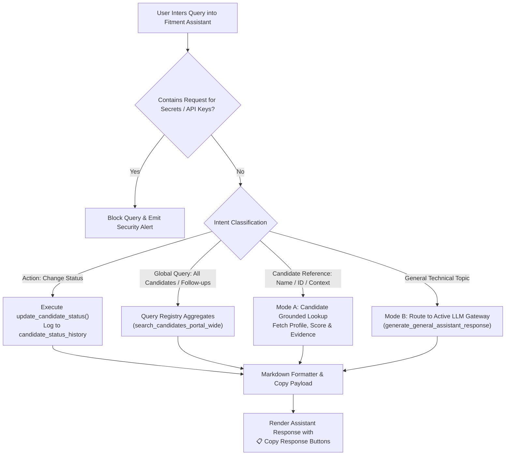

# 💬 Chatbot Modes & Intent Routing — FITMENT.AI

> **Audience**: Conversational AI Engineers, Full-Stack Developers, and System Architects.  
> **Last Reviewed**: 2026-10-19  
> **Primary Source Code**: [`chatbot.py`](file:///e:/Projects/resume-screening-agent/chatbot.py), [`llm_manager.py`](file:///e:/Projects/resume-screening-agent/llm_manager.py).

---

## 1. Dual-Mode Architecture Overview

The **Fitment Assistant** operates as a hybrid recruitment copilot capable of answering both factual candidate inquiries from the local database and general-purpose technical questions:

- **Mode A (Authoritative Candidate Intelligence)**: Queries the SQLite candidate registry (`data/fitment.db`) using parameterized SQL. Grounded 100% in verified facts. Zero hallucination.
- **Mode B (General Technical Copilot)**: Routes general engineering, protocol, or recruitment advisory questions to the configured LLM provider (Gemini, OpenRouter, NVIDIA NIM, Groq).

---

## 2. Intent Classification & Routing Rules

The routing algorithm in `chatbot.py` evaluates prompts in strict priority order:

### Priority 0: Security & Credential Protection
- **Rule**: Checks query against regex patterns for `api_key`, `secrets`, `env vars`, `database_url`, or `passwords`.
- **Response**: Immediate static response:
  > *"🔒 Security Protection Notice: System environment variables, API credentials, and internal secret tokens are strictly protected and cannot be displayed under any circumstances."*

### Priority 1: Candidate Status Update Intent
- **Rule**: Detects action verbs (`change`, `update`, `mark`, `set`, `move`, `transition`, `switch`) combined with a recruitment stage keyword (`Shortlisted`, `Rejected`, `Interview Scheduled`, etc.).
- **Execution**: Resolves candidate identity, validates stage, and executes `registry.update_candidate_status()`, writing an immutable audit record to `candidate_status_history`.

### Priority 2: Global Portal Queries
- **Rule**: Matches requests for candidate rosters, overviews, or follow-up deadlines:
  - *"Show all candidates"*, *"Who are our shortlisted candidates?"*
  - *"What follow-ups are due today?"*, *"List overdue follow-ups"*
  - *"Compare candidates for Voice L3 Lead"*
- **Execution**: Queries portal-wide registry aggregates and renders structured summary tables.

### Priority 3: Candidate-Specific Attribute Queries (Mode A)
- **Rule**: Resolves an explicit candidate name in the query (e.g. *"Tarun"*, *"Prachi’s experience"*, *"Shubhangi's contact details"*), or uses the active session candidate (`selected_candidate_id`).
- **Sub-Intents**:
  - `3A`: Candidate contact details (phone, email, location).
  - `3B`: Fitment score and breakdown (skills, experience, certifications).
  - `3C`: Matched skills and evidence snippets.
  - `3D`: Missing skills and gap analysis.
  - `3E`: Professional experience, current employer, and title.
  - `3F`: Recruitment status and audit transition history.
  - `3G`: Technical interview probing questions.
- **Disambiguation**: If a search matches multiple candidates (e.g. two candidates named "Alex"), the assistant returns a disambiguation prompt asking the recruiter to select the specific candidate ID.

### Priority 4: General Technical Copilot (Mode B)
- **Rule**: If no candidate entity is detected and the query pertains to technical engineering concepts, architecture, or interview planning:
  - *"Explain the SIP three-way handshake."*
  - *"How does Kubernetes ingress differ from a NodePort?"*
  - *"Draft an interview evaluation rubric for an SRE role."*
- **Execution**: The query is routed to `llm_manager.generate_general_assistant_response()`. If external AI APIs are offline, a graceful message prompts the user to verify provider settings.

---

## 3. Grounding & Zero-Hallucination Safeguards

1. **Exact Database Precedence**: The assistant never asks an LLM to invent candidate attributes. All candidate facts (mobile numbers, scores, company names) originate directly from SQLite `PRAGMA` tables.
2. **Deterministic Context Assembly**: When qualitative analysis is needed, the deterministic evidence payload is injected into the LLM system prompt as immutable ground truth.
3. **Copyable Workflows**: Responses are equipped with client-side JavaScript copy actions:
   - `📋 Copy Response`
   - `📄 Copy Candidate Details`
   - `🎯 Copy Fitment Summary`
   - `🎤 Copy Interview Questions`
