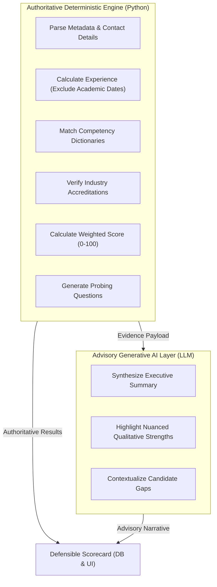

# ⚖️ Deterministic Screening vs. Generative AI — FITMENT.AI

> **Audience**: AI Researchers, Data Scientists, Compliance Auditors, and Hiring Executives.  
> **Last Reviewed**: 2026-10-19  
> **Primary Source Code**: [`deterministic_engine.py`](file:///e:/Projects/resume-screening-agent/deterministic_engine.py), [`llm_manager.py`](file:///e:/Projects/resume-screening-agent/llm_manager.py).

---

## 1. Architectural Separation of Powers

In FITMENT.AI, deterministic Python algorithms and Generative AI models operate with strict functional separation. **A generative model is never allowed to calculate a score, decide a pass/fail verdict, or invent candidate qualifications.**

---

## 2. Mathematical Scoring Model & Formula

The candidate fitment score is derived strictly through verifiable mathematics in [`deterministic_engine.py`](file:///e:/Projects/resume-screening-agent/deterministic_engine.py):

$$\text{Final Score} = \mathrm{round}\left(w_{\text{skills}} \cdot S_{\text{skills}} + w_{\text{exp}} \cdot S_{\text{exp}} + w_{\text{edu}} \cdot S_{\text{edu}} + w_{\text{certs}} \cdot S_{\text{certs}}\right)$$

### Default Weight Allocations
- **$w_{\text{skills}} = 0.30$** (30% Technical Competency Overlap)
- **$w_{\text{exp}} = 0.40$** (40% Seniority & Relevant Experience Depth)
- **$w_{\text{edu}} = 0.15$** (15% Academic Foundation & Alignment)
- **$w_{\text{certs}} = 0.15$** (15% Industry Accreditations & Certifications)

---

## 3. Sub-Score Computation Mechanics

### 3.1 Technical Skills Score ($S_{\text{skills}}$)
- **Extraction**: Mandatory and preferred skills are extracted from the Job Description using token dictionaries.
- **Matching**: Candidate resume text is evaluated for exact word and phrase boundary matches (`\b{skill}\b`).
- **Evidence Snippets**: For every matched skill, up to 2 exact sentence snippets are captured via `find_evidence_snippets()` to prove where in the resume the skill appears.
- **Calculation**:
  $$S_{\text{skills}} = \min\left(100, \; \frac{|\text{Matched Mandatory Skills}|}{|\text{Total Mandatory Skills}|} \times 100\right)$$

### 3.2 Experience Depth Score ($S_{\text{exp}}$)
- **Extraction**: `compute_candidate_experience()` parses candidate years across three priority tiers:
  1. Priority 1A: Explicit labels (`Total Exp: 14 Years`).
  2. Priority 1B: Natural prose (`having 12+ years of rich experience`).
  3. Priority 2: Work history timeline date ranges (`2018 – Present`).
- **Academic Filter Safeguard**: Lines containing `CBSE`, `ICSE`, `10th`, `12th`, `B.Tech`, `B.E`, `MCA`, `BCA`, `University`, or `School` are explicitly excluded from work timeline spans. This prevents school or college graduation years (e.g. 2004) from being falsely counted as 22 years of IT tenure.
- **Calculation**:
  $$S_{\text{exp}} = \min\left(100, \; \frac{\text{Detected Relevant Years}}{\text{Required Years in JD}} \times 100\right)$$

### 3.3 Certifications Score ($S_{\text{certs}}$)
- **Verification**: `detect_certifications()` checks candidate text against normalized regex patterns:
  - Networking: Cisco CCNA, CCNP, CCIE (Routing/Switching, Security, Collaboration, Enterprise).
  - Cloud: AWS Solutions Architect, Azure Administrator/Architect, Google Cloud Professional.
  - DevOps & Security: CKA, CKAD, CISSP, CEH, CompTIA Security+.
  - Management: PMP, ITIL, Agile Scrum Master.
- **Calculation**:
  - Minimum 1 required certification found $\rightarrow 80–100$.
  - Desired certifications detected $\rightarrow 50–80$.
  - No matching certifications $\rightarrow 0$.

---

## 4. Verdicts & Authoritative Recommendations

Based on the calculated mathematical score, the deterministic engine issues an authoritative hiring verdict:

| Score Range | Authoritative Verdict | Recommendation Logic (`generate_grounded_recommendation`) |
| :--- | :--- | :--- |
| **75 – 100** | **Strong Fit** (Green) | Candidate demonstrates strong competency alignment. Recommend advancing to technical interview rounds. |
| **55 – 74** | **Moderate Fit** (Amber) | Candidate satisfies core baseline requirements but exhibits specific skill gaps. Recommend targeted technical screening focused on missing skills. |
| **0 – 54** | **Weak Fit** (Red) | Significant deficit in required domain skills or minimum experience depth. Recommend rejection or talent pool hold. |

---

## 5. Side-by-Side Comparison: Deterministic Core vs. Generative AI

| Dimension | Deterministic Engine | Generative AI Layer |
| :--- | :--- | :--- |
| **Execution Environment** | Local Python runtime (`re`, `math`). | External cloud endpoints (Gemini, OpenRouter, NVIDIA, Groq). |
| **Hallucination Risk** | **0% (Zero)**: Operates strictly on present text tokens. | Moderate: Models may extrapolate or assume background not in CV. |
| **Reproducibility** | **100%**: Deterministic input produces identical output. | Variable: Subject to model sampling temperature and token variations. |
| **Network Requirement** | **None**: Functions 100% offline. | Requires outbound HTTPS access to LLM APIs. |
| **Primary Output** | Score (0–100), Verdict, Matched/Missing lists, Probing Questions. | Qualitative narrative, executive perspective, nuanced summary. |
| **Legal Defensibility** | High: Clear mathematical paper trail for audits. | Low: Black-box output unsuited for compliance justification. |
| **Best Used For** | Initial filtering, scoring, compliance, skill verification. | Qualitative interview preparation, contextual synthesis. |
