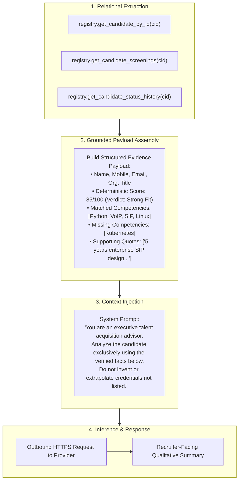

# 🔍 Grounding and Retrieval Architecture — FITMENT.AI

> **Audience**: Solution Architects, Search Engineers, and AI Governance Committees.  
> **Last Reviewed**: 2026-10-19  
> **Primary Source Code**: [`chatbot.py`](file:///e:/Projects/resume-screening-agent/chatbot.py), [`registry.py`](file:///e:/Projects/resume-screening-agent/registry.py), [`multi_agents.py`](file:///e:/Projects/resume-screening-agent/multi_agents.py).

---

## 1. Architectural Reality: Relational Grounding vs. Vector RAG

A frequent question in technical architecture reviews is whether FITMENT.AI implements **Vector-based Retrieval-Augmented Generation (Vector RAG)** or **Structured Database Grounding**.

### The Production Truth
- **Production Architecture**: FITMENT.AI implements **Relational Database Grounding (SQL-Augmented Generation)**. It queries candidate records, scores, skills, and follow-ups directly from SQLite via parameterized queries.
- **Experimental Code**: An early exploratory script ([`multi_agents.py`](file:///e:/Projects/resume-screening-agent/multi_agents.py)) experimented with LangChain, ChromaDB, and `HuggingFaceInstructEmbeddings`. However, this was superseded in production by the deterministic relational core.

```text
┌────────────────────────────────────────────────────────────────────────┐
│                        RETRIEVAL METHODOLOGY                           │
├──────────────────────────────────┬─────────────────────────────────────┤
│   PRODUCTION: RELATIONAL SQL     │       EXPERIMENTAL: VECTOR RAG      │
│     (Implemented in Core)        │         (multi_agents.py)           │
├──────────────────────────────────┼─────────────────────────────────────┤
│ • Exact entity lookup (Name/ID)  │ • Chunk-based text splitting        │
│ • Deterministic score retrieval  │ • Cosine similarity embeddings      │
│ • 100% precision on phone/email  │ • Fuzzy recall, potential loss of   │
│ • Zero chunking or boundary loss │   exact numbers or phone digits     │
│ • Zero GPU/embedding overhead   │ • High embedding computational cost │
│ • Complete offline execution     │ • Prone to semantic drift           │
└──────────────────────────────────┴─────────────────────────────────────┘
```

---

## 2. Why Relational Grounding Outperforms Vector RAG for Recruitment

In talent acquisition decision-support systems, precision and data fidelity are paramount:

1. **Exact Contact Details**: Vector chunking often splits phone numbers or email addresses across chunk boundaries (e.g., chunk 1 ends with `+91-987` and chunk 2 starts with `6543210`), corrupting candidate contact details. SQL retrieval fetches the atomic `candidates.mobile` field intact.
2. **Deterministic Mathematical Integrity**: Vector similarity cannot guarantee that a candidate's fitment score is exactly `85/100`. It might retrieve an older screening or another candidate's score with high semantic similarity. SQL queries `screenings` filtered by `candidate_id` and ordered by `screening_timestamp DESC`.
3. **Audit Trail Completeness**: Status history requires strict chronological order (`candidate_status_history` sorted by timestamp). Vector retrieval destroys chronological relationships.

---

## 3. Grounded Context Construction Flow

When the Fitment Assistant or LLM Manager synthesizes a qualitative candidate analysis, context is assembled systematically:



---

## 4. Context Window & Token Governance

- **Token Budgeting**: Because the deterministic engine pre-filters the resume and extracts only relevant competencies, evidence snippets, and metadata, the context sent to the LLM is typically between **400 and 1,200 tokens**.
- **Efficiency**: Rather than feeding an entire 8-page raw PDF into the model, only high-signal extracted data is transmitted.
- **Cost Reduction**: This reduces LLM API token consumption by up to **85%** compared to naive document stuffing.
