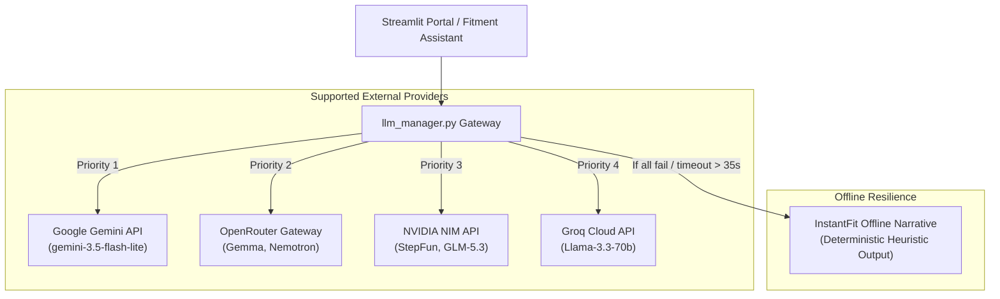

# 🔌 AI Provider Integration & Gateway — FITMENT.AI

> **Audience**: Platform Engineers, Cloud Architects, and AI Integrators.  
> **Last Reviewed**: 2026-10-19  
> **Primary Source Code**: [`llm_manager.py`](file:///e:/Projects/resume-screening-agent/llm_manager.py).

---

## 1. Provider Ecosystem Architecture

FITMENT.AI incorporates a resilient, unified multi-provider gateway in [`llm_manager.py`](file:///e:/Projects/resume-screening-agent/llm_manager.py). The gateway abstracts differences in API formats, handles rate limits, validates health connectivity, and executes automatic failovers:



---

## 2. Supported Provider Catalog & Specifications

The gateway defines specifications in the `PROVIDER_SPECS` dictionary:

### 2.1 Google Gemini
- **Display Name**: `Google Gemini (gemini-3.5-flash-lite)`
- **Default Model**: `gemini-3.5-flash-lite`
- **Supported Models**: `gemini-3.5-flash-lite`, `gemini-2.5-flash`, `gemini-2.5-pro`
- **Environment Variable**: `GEMINI_API_KEY` (or `GOOGLE_API_KEY`)
- **Base URL**: `https://generativelanguage.googleapis.com/v1beta/models/{model}:generateContent`
- **Protocol**: Direct Google Generative Language REST JSON API.

### 2.2 OpenRouter (Free Tier Catalog)
- **Display Name**: `OpenRouter (Free / Cloud LLMs)`
- **Default Model**: `google/gemma-4-26b-a4b-it:free`
- **Supported Models**: `google/gemma-4-26b-a4b-it:free`, `nvidia/nemotron-3.5-lightning:free`
- **Environment Variable**: `OPENROUTER_API_KEY`
- **Base URL**: `https://openrouter.ai/api/v1/chat/completions`
- **Protocol**: OpenAI-compatible chat completions JSON. Includes `HTTP-Referer` and `X-Title: FITMENT.AI` headers.

### 2.3 NVIDIA NIM
- **Display Name**: `NVIDIA NIM`
- **Default Model**: `stepfun-ai/step-5-preview`
- **Supported Models**: `stepfun-ai/step-5-preview`, `z-ai/glm-5.3`, `meta/llama-3.1-70b-instruct`
- **Environment Variable**: `NVIDIA_API_KEY`
- **Base URL**: `https://integrate.api.nvidia.com/v1/chat/completions`
- **Protocol**: OpenAI-compatible chat completions JSON.

### 2.4 Groq Cloud
- **Display Name**: `Groq Cloud`
- **Default Model**: `llama-3.3-70b-versatile`
- **Supported Models**: `llama-3.3-70b-versatile`, `llama-3.1-8b-instant`
- **Environment Variable**: `GROQ_API_KEY`
- **Base URL**: `https://api.groq.com/openai/v1/chat/completions`
- **Protocol**: High-speed LPU inference via OpenAI-compatible endpoints.

### 2.5 InstantFit Offline Screening
- **Display Name**: `⚡ InstantFit Offline Screening`
- **Protocol**: Local Python heuristic narrative synthesis. Zero external calls, zero network overhead.

---

## 3. Health Probes & In-Memory Validation Caching

To avoid blocking UI interactions with redundant network checks on every Streamlit script execution, provider connectivity is validated via `validate_provider_health()` and cached in session memory:

```python
val_cache_key = f"{p_id}::{user_api_key.strip()}::{selected_model}"
if val_cache_key in st.session_state.provider_val_cache:
    is_valid, validation_msg = st.session_state.provider_val_cache[val_cache_key]
else:
    is_valid, validation_msg = llm_manager.validate_provider_health(
        p_id, api_key=user_api_key.strip(), model=selected_model, timeout_seconds=8.0
    )
    st.session_state.provider_val_cache[val_cache_key] = (is_valid, validation_msg)
```

- **Health Probe Payload**: Dispatches a minimal 1-token test prompt (`"hi"`) with a tight 8-second timeout.
- **Visual Feedback**: If valid, renders `✨ AI Service: Connected`. If invalid or unconfigured, displays `⚡ InstantFit Offline Screening Active`.

---

## 4. Timeout Governance & Fallback Chain

External AI inference is governed by a strict timeout budget:
```python
DEFAULT_TIMEOUT = 35.0  # seconds
```

If a provider hangs or exceeds 35 seconds:
1. The socket connection is aborted immediately.
2. The failure is logged internally (`logger.warning`).
3. The gateway evaluates the next eligible provider in the fallback order.
4. If all configured providers fail or no API keys exist, the gateway returns:
   ```json
   {
       "status": "offline_fallback",
       "text": "... [Deterministic Rule-Based Executive Summary] ...",
       "provider": "Offline / Deterministic"
   }
   ```
5. The screening report renders cleanly with zero crash or disruption to the recruiter.
