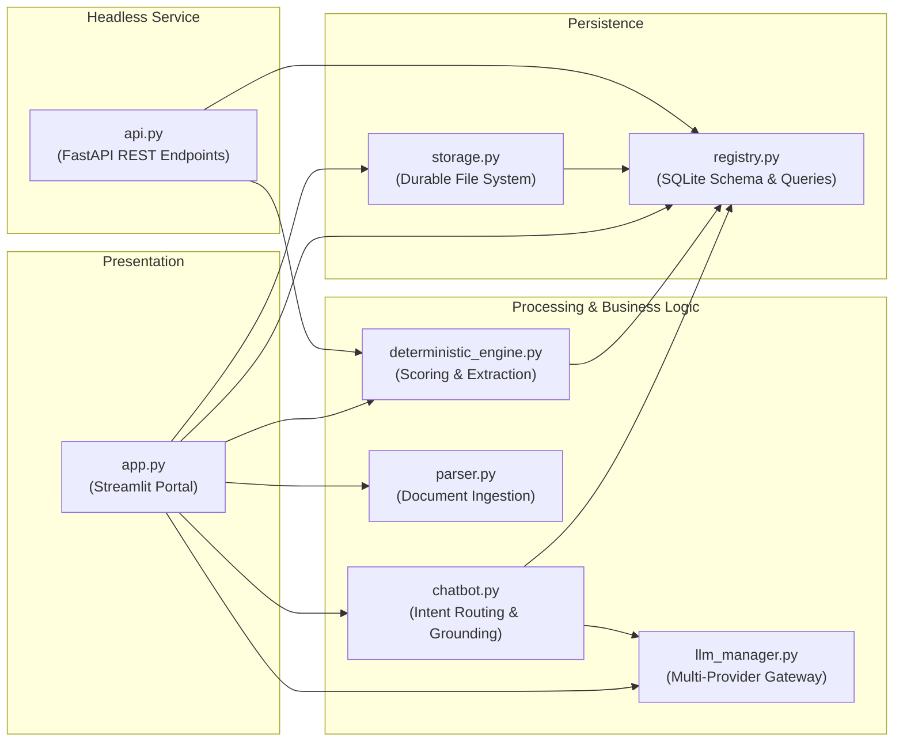

# 🧩 Application Components — FITMENT.AI Recruitment Intelligence Platform

> **Audience**: Backend Engineers, Platform Developers, and Code Reviewers.  
> **Last Reviewed**: 2026-10-19  
> **Related Documents**: [`APPLICATION_ARCHITECTURE.md`](file:///e:/Projects/resume-screening-agent/APPLICATION_ARCHITECTURE.md), [`docs/architecture/data-flow.md`](file:///e:/Projects/resume-screening-agent/docs/architecture/data-flow.md).

---

## 1. Component Map & Architecture Overview

The FITMENT.AI platform is structured as an ensemble of specialized Python modules with clean boundaries and single-responsibility contracts:

---

## 2. Detailed Component Breakdown

### 2.1 Presentation Orchestrator (`app.py`)
- **File Path**: [`app.py`](file:///e:/Projects/resume-screening-agent/app.py)
- **Purpose**: Controls the Streamlit web portal, rendering responsive UI layouts, managing session state across navigation views, handling file upload events, and rendering interactive scorecards.
- **Key Functions**:
  - `render_welcome_banner()`: Renders the top summary banner, live IST clock pill, and daily activity metrics.
  - `_live_clock_fragment()`: Streamlit fragment running on a 5-second interval (`@st.fragment(run_every="5s")`) for isolated clock ticking.
  - `render_donut_chart(score)`: Produces inline SVG circular progress scorecards.
  - `render_copy_actions(content, key_suffix)`: Creates client-side JavaScript buttons for instant clipboard copying.
- **Inputs**: User interaction events, uploaded file objects, session state triggers.
- **Outputs**: HTML/CSS elements, Streamlit widgets, candidate evaluation dossier markdown files.
- **Dependencies**: `streamlit`, `registry`, `storage`, `parser`, `deterministic_engine`, `llm_manager`, `chatbot`.
- **Error Conditions**: Catches document parsing exceptions, displays non-blocking user warnings, and safeguards against widget re-instantiation errors.
- **Testing**: End-to-end integration tests in [`tests/test_daily_analytics_navigation_timestamps.py`](file:///e:/Projects/resume-screening-agent/tests/test_daily_analytics_navigation_timestamps.py).

---

### 2.2 Authoritative Screening Engine (`deterministic_engine.py`)
- **File Path**: [`deterministic_engine.py`](file:///e:/Projects/resume-screening-agent/deterministic_engine.py)
- **Purpose**: Zero-hallucination mathematical evaluation engine. Extracts candidate profiles, matches required vs. detected skills, parses experience depth, verifies certifications, and calculates weighted scores.
- **Key Functions**:
  - `evaluate_candidate_deterministically(jd_text, cv_text, weights)`: Main entry point returning full scorecard dictionary.
  - `compute_candidate_experience(resume_text)`: Multi-priority regex engine extracting total and domain experience while ignoring graduation dates.
  - `extract_candidate_metadata(resume_text)`: Extracts name, phone number, email, location, current company, and title.
  - `detect_certifications(resume_text)`: Maps certifications against accredited industry dictionaries.
  - `generate_grounded_recommendation(score, verdict, missing_skills)`: Synthesizes authoritative hiring recommendations.
- **Inputs**: Plain text of job description, plain text of resume, optional category weight allocations.
- **Outputs**: Structured evaluation dictionary containing `match_score`, `verdict`, `skills_score`, `exp_score`, `cert_score`, `skills_matched`, `missing_skills`, `supporting_evidence`, and `interview_questions`.
- **Dependencies**: `re`, `datetime`, `parser`.
- **Data Ownership**: Does not own persistent data; acts as a pure functional evaluation engine.
- **Testing**: Verified by [`tests/test_deterministic_engine.py`](file:///e:/Projects/resume-screening-agent/tests/test_deterministic_engine.py).

---

### 2.3 Candidate Registry & Relational Persistence (`registry.py`)
- **File Path**: [`registry.py`](file:///e:/Projects/resume-screening-agent/registry.py)
- **Purpose**: Controls the SQLite database (`data/fitment.db`), connection pooling, schema migrations, and relational CRUD operations.
- **Key Functions**:
  - `init_db(db_path)`: Idempotently creates tables and indexes.
  - `upsert_candidate(...)`: Saves or updates candidate records without overwriting historical registration timestamps.
  - `save_screening(...)`: Records screening evaluation events with JSON-encoded metrics.
  - `get_dashboard_analytics_summary(db_path)`: Computes calendar-day counts in `Asia/Kolkata` (IST) using boundary queries alongside all-time aggregates.
  - `format_last_screened(timestamp_str)`: Formats ISO-8601 timestamps into standardized `DD Mon YYYY, HH:MM:SS IST`.
- **Inputs**: Candidate profiles, screening results, status transitions, follow-up deadlines.
- **Outputs**: Relational database records, dictionaries, and query cursors.
- **Dependencies**: `sqlite3`, `contextlib`, `zoneinfo`, `datetime`.
- **Data Ownership**: Owns all SQLite tables (`candidates`, `jobs`, `screenings`, `candidate_status_history`, `follow_ups`, `stored_files`, `screening_files`).
- **Testing**: Verified by [`tests/test_portal_upgrades.py`](file:///e:/Projects/resume-screening-agent/tests/test_portal_upgrades.py) and [`tests/test_daily_analytics_navigation_timestamps.py`](file:///e:/Projects/resume-screening-agent/tests/test_daily_analytics_navigation_timestamps.py).

---

### 2.4 Durable File Storage Engine (`storage.py`)
- **File Path**: [`storage.py`](file:///e:/Projects/resume-screening-agent/storage.py)
- **Purpose**: Physical file persistence engine enforcing directory structures, SHA-256 deduplication, and path-traversal security.
- **Key Functions**:
  - `save_job_description_file(file_bytes, filename, ...)`: Persists job descriptions under `data/job_descriptions/`.
  - `save_resume_file(file_bytes, filename, ...)`: Persists candidate resumes under `data/resumes/`.
  - `resolve_stored_path(raw_path, base_dir)`: Validates path safety via `os.path.commonpath`.
  - `read_stored_file_bytes(file_ref, base_dir)`: Reads bytes of saved files for processing or download.
  - `list_saved_job_descriptions()` / `list_saved_resumes()`: Catalogs available documents for UI pickers.
- **Inputs**: Raw document bytes, filenames, candidate and job identifiers.
- **Outputs**: File metadata dictionaries, physical files on disk.
- **Dependencies**: `os`, `hashlib`, `shutil`, `tempfile`, `registry`.
- **Data Ownership**: Owns physical files under `data/job_descriptions/` and `data/resumes/`.
- **Testing**: Verified by [`tests/test_file_storage.py`](file:///e:/Projects/resume-screening-agent/tests/test_file_storage.py).

---

### 2.5 Document Parser (`parser.py`)
- **File Path**: [`parser.py`](file:///e:/Projects/resume-screening-agent/parser.py)
- **Purpose**: Extracts sanitized plain text from diverse document formats.
- **Key Functions**:
  - `extract_text_from_pdf(file_source, min_characters)`: Extracts text using `pypdf.PdfReader` with decryption support.
  - `extract_text_from_docx(file_source, min_characters)`: Parses DOCX paragraphs and tables using `python-docx`.
  - `extract_text_from_txt(file_source, min_characters)`: Reads UTF-8 text with robust fallback.
  - `extract_text_from_file(file_source, filename)`: Universal router based on file extension.
  - `clean_text(text)`: Strips non-printable ASCII, control sequences, and excessive whitespace.
- **Inputs**: File paths, byte streams, or Streamlit UploadedFile objects.
- **Outputs**: Cleaned text strings and page counts.
- **Dependencies**: `pypdf`, `python-docx`, `re`, `io`.
- **Error Conditions**: Raises `PDFParsingError`, `EmptyDocumentError`, or `DocumentProcessingError`.

---

### 2.6 Fitment Assistant (`chatbot.py`)
- **File Path**: [`chatbot.py`](file:///e:/Projects/resume-screening-agent/chatbot.py)
- **Purpose**: Conversational AI copilot providing database-grounded candidate intelligence (Mode A) and general technical advice (Mode B).
- **Key Functions**:
  - `FitmentAssistant.ask(user_query, selected_candidate_id, ...)`: Core routing method.
  - `resolve_candidate_for_query(query, selected_id, db_path)`: Identifies target candidate by name, possessive syntax, or active context.
  - `resolve_status_from_text(text)`: Identifies recruitment lifecycle stages from conversational prompts.
  - `format_candidate_profile(cand, latest_screening)`: Generates structured markdown profiles with contact info and scores.
- **Inputs**: User chat queries, active candidate selection, provider configuration.
- **Outputs**: Response dictionary containing `answer`, `candidate_id`, `needs_disambiguation`, and copy metadata.
- **Dependencies**: `registry`, `llm_manager`, `re`, `json`.

---

### 2.7 AI Provider Gateway (`llm_manager.py`)
- **File Path**: [`llm_manager.py`](file:///e:/Projects/resume-screening-agent/llm_manager.py)
- **Purpose**: Unified interface to cloud LLM providers, governing API keys, timeouts, and offline failovers.
- **Key Functions**:
  - `validate_provider_health(provider_id, api_key, model, timeout_seconds)`: Lightweight connectivity test.
  - `generate_qualitative_assessment(jd_text, cv_text, evidence, ...)`: Generates narrative screening summaries.
  - `generate_general_assistant_response(user_query, ...)`: Handles open-ended technical questions.
- **Inputs**: Prompts, candidate evidence, API credentials, timeout parameters.
- **Outputs**: Structured responses with `status`, `text`, `provider`, and `model`.
- **Dependencies**: `urllib.request`, `json`, `os`.

---

### 2.8 Headless REST Service (`api.py`)
- **File Path**: [`api.py`](file:///e:/Projects/resume-screening-agent/api.py)
- **Purpose**: Exposes deterministic screening and candidate querying via FastAPI.
- **Key Endpoints**:
  - `POST /screen`: Evaluates JD and resume text payloads.
  - `POST /screen/upload`: Accepts file uploads.
  - `GET /candidates`: Lists registered candidates.
  - `GET /health`: System health probe.
- **Dependencies**: `fastapi`, `pydantic`, `deterministic_engine`, `registry`.
- **Testing**: Verified by [`tests/test_api.py`](file:///e:/Projects/resume-screening-agent/tests/test_api.py).
