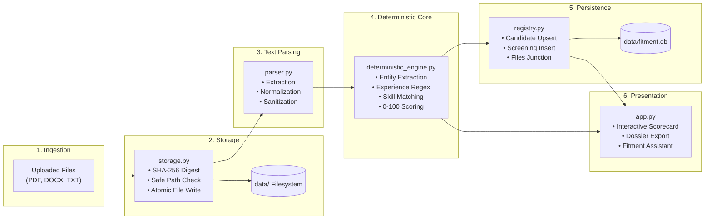

# 🔄 Data Flow Architecture — FITMENT.AI Recruitment Intelligence Platform

> **Audience**: Data Engineers, Software Architects, and Systems Integrators.  
> **Last Reviewed**: 2026-10-19  
> **Related Documents**: [`docs/architecture/sequence-diagrams.md`](file:///e:/Projects/resume-screening-agent/docs/architecture/sequence-diagrams.md), [`DATA_ARCHITECTURE.md`](file:///e:/Projects/resume-screening-agent/DATA_ARCHITECTURE.md).

---

## 1. High-Level Ingestion and Processing Pipeline

Data flows through FITMENT.AI across six distinct stages, transforming raw unstructured binary documents into structured, queryable recruitment intelligence:

---

## 2. Detailed Pipeline Stages

### Stage 1: Document Ingestion & Durable File Storage
1. **User Action**: The recruiter drags and drops a Job Description or Resume file into the Streamlit file uploader widget.
2. **File Interception**: The raw byte payload is passed to [`storage.py`](file:///e:/Projects/resume-screening-agent/storage.py).
3. **Cryptographic Checksum**: The SHA-256 hash of the byte buffer is computed:
   - If the hash already exists in `stored_files` and the file is present on disk, the existing file record is reused (deduplication).
   - If the hash is new, a unique collision-safe filename is generated:
     - `jd_<clean_title>_<hash>.docx` or `cv_<candidate_name>_<hash>.pdf`.
4. **Atomic Write**: The file is written to a temporary file (`tempfile.mkstemp`) and atomically moved (`os.replace`) into `data/job_descriptions/` or `data/resumes/`.
5. **Registry Tracking**: A record is inserted into `stored_files` capturing original filename, stored path, size, hash, and upload timestamp.

---

### Stage 2: Document Parsing & Text Normalization
1. **Parser Selection**: [`parser.py`](file:///e:/Projects/resume-screening-agent/parser.py) inspects the file extension and routes the byte stream:
   - `.pdf` -> `extract_text_from_pdf()` using `pypdf.PdfReader`.
   - `.docx`, `.doc` -> `extract_text_from_docx()` using `python-docx`.
   - `.txt`, `.md` -> `extract_text_from_txt()` using UTF-8 decoding with replacement fallback.
2. **Sanitization**: `clean_text()` strips non-printable ASCII characters, cleans malformed ligatures, and normalizes excessive consecutive whitespace and line breaks.
3. **Validation**: If the extracted text contains fewer than 30–40 characters, an `EmptyDocumentError` is raised with instructions to provide selectable text rather than flattened scanned images.

---

### Stage 3: Authoritative Deterministic Scoring
1. **Candidate Profile Extraction**:
   - `extract_candidate_metadata()` searches the resume text for name, mobile number (E.164 normalization), email address, location, current organization, and job title using regular expressions.
2. **Seniority Evaluation**:
   - `compute_candidate_experience()` parses candidate tenure across three priority tiers (explicit labels like *"Total Experience: 15 Years"*, natural prose like *"having 12+ years of experience"*, and work history date ranges).
   - **Academic Filter**: Automatically excludes lines referencing degrees, schooling, CBSE, ICSE, or university graduation dates to prevent artificial experience inflation.
3. **Accreditation Verification**:
   - `detect_certifications()` checks for verified certifications (Cisco CCNA/CCNP/CCIE, AWS Certified Solutions Architect, Kubernetes CKA, CISSP, PMP).
4. **Competency Matching**:
   - Mandatory and preferred skills extracted from the Job Description are cross-referenced against candidate resume tokens.
   - Matched skills and missing skill gaps are identified.
   - Snippets showing sentence-level supporting evidence are collected.
5. **Weighted Mathematical Scoring**:
   $$\text{Final Score} = (w_{\text{skills}} \cdot S_{\text{skills}}) + (w_{\text{exp}} \cdot S_{\text{exp}}) + (w_{\text{edu}} \cdot S_{\text{edu}}) + (w_{\text{certs}} \cdot S_{\text{certs}})$$
   The resulting integer score (0–100) dictates the verdict:
   - $\ge 75$: **Strong Fit** (Green)
   - $55 - 74$: **Moderate Fit** (Amber)
   - $< 55$: **Weak Fit** (Red)

---

### Stage 4: Relational Database Persistence
1. **Candidate Upsert**: [`registry.upsert_candidate()`](file:///e:/Projects/resume-screening-agent/registry.py) checks if a candidate already exists by matching mobile number, email, or normalized name. If found, profile details are refreshed while preserving the original `created_at` timestamp.
2. **Requisition Registration**: `registry.upsert_job()` inserts or updates the target job requisition.
3. **Screening Insertion**: `registry.save_screening()` writes the complete evaluation record to `screenings`. Matched skills, missing skills, supporting evidence, and interview probing questions are serialized into JSON strings.
4. **Junction Association**: `registry.associate_screening_files()` records the exact file IDs for both the JD and the resume in `screening_files`.
5. **Status Auditing**: When recruiters update candidate statuses, `candidate_status_history` captures an immutable record with recruiter notes and timestamp.

---

### Stage 5: Optional Generative AI Synthesis
1. **Trigger Condition**: Occurs only if an external AI provider (Gemini, OpenRouter, NVIDIA NIM, Groq) is selected and verified.
2. **Evidence Packaging**: The deterministic results (verdict, matched skills, missing skills, candidate title) are bundled into a structured prompt.
3. **Outbound Call**: The request is dispatched via [`llm_manager.py`](file:///e:/Projects/resume-screening-agent/llm_manager.py) with a 35-second timeout budget.
4. **Fallback Handling**: If the provider fails, exceeds 35 seconds, or encounters rate limits (HTTP 429), the platform falls back to an offline deterministic summary without interrupting the user.

---

### Stage 6: Conversational Retrieval (Fitment Assistant)
1. **User Inquiry**: The recruiter submits a query in the chat companion (e.g. *"What is Shubhangi's score and contact number?"*).
2. **Security Interception**: Queries attempting to reveal system secrets (`api_key`, `DATABASE_URL`) are immediately rejected.
3. **Entity Resolution**: `resolve_candidate_for_query()` identifies the target candidate from the query string or active session context.
4. **Database Query**: A parameterized SQL query retrieves candidate facts from SQLite.
5. **Response Delivery**: A formatted markdown response is generated alongside instant client-side clipboard copy actions.
