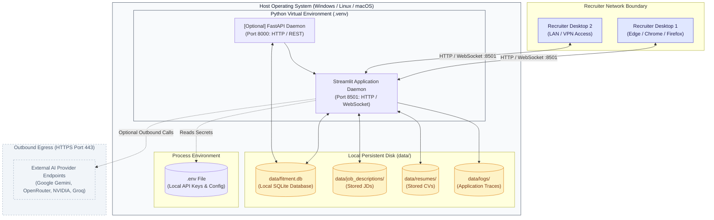

# 🚀 Deployment Architecture — FITMENT.AI Recruitment Intelligence Platform

> **Audience**: Systems Administrators, DevOps Engineers, and Infrastructure Specialists.  
> **Last Reviewed**: 2026-10-19  
> **Primary Source Code**: [`.streamlit/config.toml`](file:///e:/Projects/resume-screening-agent/.streamlit/config.toml), [`app.py`](file:///e:/Projects/resume-screening-agent/app.py), [`api.py`](file:///e:/Projects/resume-screening-agent/api.py).

---

## 1. Actual Implemented Deployment Topology

**FITMENT.AI** is deployed as an on-premise, self-hosted Python web application. It runs directly on recruiter workstations or dedicated internal application servers within corporate network perimeters.



> [!NOTE]
> This documentation reflects the actual verified setup. The platform is intentionally not packaged with Docker containers or Kubernetes manifests in this repository, operating as a lightweight, bare-metal Python service.

---

## 2. Server Startup & Execution Models

### 2.1 Streamlit Web Portal (Primary Interface)

#### Local Workstation Mode (Default Development)
```powershell
streamlit run app.py
```
- Launches the local Streamlit server.
- Automatically opens the default web browser at `http://localhost:8501`.
- Enables file watcher live-reloading.

#### Headless / Network Host Mode (Internal Server Deployment)
```powershell
streamlit run app.py --server.port 8501 --server.address 0.0.0.0 --server.headless true
```
- **`--server.port 8501`**: Binds the application to TCP port 8501.
- **`--server.address 0.0.0.0`**: Listens on all host network interfaces, allowing team members on the corporate LAN or VPN to access the dashboard at `http://<server-ip>:8501`.
- **`--server.headless true`**: Prevents the application from attempting to open a browser window upon server launch.

---

### 2.2 Streamlit Configuration ([`.streamlit/config.toml`](file:///e:/Projects/resume-screening-agent/.streamlit/config.toml))

Application styling and server behaviors are controlled via the repository's `.streamlit/config.toml`:

```toml
[theme]
base = "light"
primaryColor = "#2563EB"
backgroundColor = "#F3F6FC"
secondaryBackgroundColor = "#FFFFFF"
textColor = "#172033"
font = "sans serif"

[server]
headless = true
enableCORS = false
enableXsrfProtection = true
maxUploadSize = 15
```

- **`maxUploadSize = 15`**: Enforces a strict 15 MB limit per uploaded resume or job description to safeguard memory allocations.
- **`enableXsrfProtection = true`**: Defends against cross-site request forgery attacks on WebSocket transport channels.

---

### 2.3 Headless REST API (Optional Microservice)

For headless recruitment integrations or automated ATS pipelines, the optional FastAPI service can be launched concurrently:

```powershell
uvicorn api:app --host 0.0.0.0 --port 8000 --reload
```
- API Documentation (Swagger / OpenAPI): `http://localhost:8000/docs`.
- Alternative ReDoc Explorer: `http://localhost:8000/redoc`.

---

## 3. Network & Firewall Configuration

| Port | Protocol | Direction | Source | Destination | Purpose |
| :--- | :--- | :--- | :--- | :--- | :--- |
| **8501** | TCP / HTTP & WS | Inbound | Recruiter Browsers | Streamlit Portal | Primary UI, dashboard, candidate tracker, and chatbot. |
| **8000** | TCP / HTTP | Inbound | ATS / API Clients | FastAPI Daemon | Optional REST screening endpoints (`/screen`, `/candidates`). |
| **443** | TCP / HTTPS | Outbound | Streamlit Host | Cloud AI Providers | Outbound REST calls for optional qualitative summaries (`generativelanguage.googleapis.com`, `openrouter.ai`, `api.nvidia.com`, `api.groq.com`). |

---

## 4. Background Daemon Management (PowerShell / Windows)

When deployed on Windows server environments without container engines:

```powershell
# Start Streamlit in background detached process:
Start-Process powershell -ArgumentList "-NoExit", "-Command", "streamlit run app.py --server.port 8501 --server.headless true" -WindowStyle Hidden

# Identify running Streamlit process:
Get-WmiObject Win32_Process | Where-Object { $_.CommandLine -like "*streamlit*app.py*" } | Select-Object ProcessId, CommandLine

# Terminate running Streamlit server:
Stop-Process -Id <ProcessId> -Force
```
