# 🛡️ Error Handling & Fault Tolerance — FITMENT.AI Recruitment Intelligence Platform

> **Audience**: Reliability Engineers, Backend Developers, and Support Engineers.  
> **Last Reviewed**: 2026-10-19  
> **Primary Source Code**: [`parser.py`](file:///e:/Projects/resume-screening-agent/parser.py), [`storage.py`](file:///e:/Projects/resume-screening-agent/storage.py), [`llm_manager.py`](file:///e:/Projects/resume-screening-agent/llm_manager.py), [`registry.py`](file:///e:/Projects/resume-screening-agent/registry.py).

---

## 1. Resilience Philosophy

**FITMENT.AI** is engineered under a strict **Zero-Panic Principle**:
> *No user input error, corrupted document, network timeout, or third-party cloud outage should ever cause an uncaught Python exception or crash the Streamlit web portal.*

The architecture implements layered defense-in-depth across each subsystem:

```mermaid
flowchart TD
    subgraph Layer1 ["Layer 1: Input & Document Parsing"]
        DocInput["Document File / Text"] --> ParseCheck{"Valid Format & Length?"}
        ParseCheck -->|No| UserWarning["Non-Blocking Flash Banner<br/>(st.warning / st.error)"]
        ParseCheck -->|Yes| CoreProcess["Deterministic Analysis"]
    end

    subgraph Layer2 ["Layer 2: File Storage & Path Traversal"]
        FileSave["Save File to Disk"] --> PathCheck{"Canonical Path inside data/?"}
        PathCheck -->|Escape Attempt| SecAlert["Security Exception Block<br/>(PermissionError logged)"]
        PathCheck -->|Valid| AtomicWrite["Atomic Temp File Write"]
    end

    subgraph Layer3 ["Layer 3: External AI Inference"]
        AIFetch["LLM Qualitative Call"] --> TimeoutCheck{"Provider returns in < 35s?"}
        TimeoutCheck -->|Timeout / HTTP 429| FallbackEngine["Automatic Offline Narrative<br/>(InstantFit Heuristic Output)"]
        TimeoutCheck -->|Success| OnlineNarrative["Rich AI Summary"]
    end

    subgraph Layer4 ["Layer 4: Relational Persistence"]
        DBOp["SQLite Transaction"] --> DBCheck{"Locks or Constraint Errors?"}
        DBCheck -->|Locked / Busy| Retry["Busy Timeout & Clean Rollback"]
        DBCheck -->|Valid| Commit["Atomic Commit"]
    end
```



---

## 2. Failure Domain Analysis & Mitigation Catalog

### 2.1 Document Ingestion & Parsing Failures ([`parser.py`](file:///e:/Projects/resume-screening-agent/parser.py))

| Failure Mode | Trigger Scenario | Architectural Mitigation | User Impact |
| :--- | :--- | :--- | :--- |
| **Corrupted PDF** | Truncated binary stream or invalid PDF header. | `extract_text_from_pdf()` catches `PdfReadError` and wraps in `PDFParsingError`. | UI displays: *"Corrupted or invalid PDF format. Please re-save or upload DOCX."* |
| **Password Protected PDF** | Encrypted CV uploaded without credentials. | Checks `reader.is_encrypted` and attempts empty-string decryption. If it fails, raises `PDFParsingError`. | UI displays: *"The PDF file is encrypted and password-protected."* |
| **Scanned Flattened Image** | Scanned document with zero selectable text tokens. | Length check verifies `len(cleaned_text.strip()) >= min_characters` (30–40 chars). | UI displays: *"Extracted content is too short or empty. Ensure the PDF contains selectable text (not scanned images)."* |
| **DOCX Structure Error** | Invalid XML markup or zip archive corruption. | `extract_text_from_docx()` catches general exceptions, logs them, and raises `DocumentProcessingError`. | Clean error banner; prevents Streamlit server crash. |

---

### 2.2 Storage & Filesystem Security Failures ([`storage.py`](file:///e:/Projects/resume-screening-agent/storage.py))

| Failure Mode | Trigger Scenario | Architectural Mitigation | Security Protection |
| :--- | :--- | :--- | :--- |
| **Path Traversal Attack** | Malicious filename containing `../../` or absolute drive path (`C:\Windows\...`). | `resolve_stored_path()` computes `os.path.commonpath([base_dir, target])`. If target escapes base, raises `PermissionError`. | Blocks arbitrary file read/write across the host filesystem. |
| **Partial File Corruption** | Server crash or disk full during multi-megabyte upload. | Writes bytes to temporary file via `tempfile.mkstemp(dir=base_dir)`, verifies length, and executes atomic `os.replace()`. | Target files are never partially written or corrupted. |
| **Missing Document on Disk** | Database references a file deleted manually by an administrator. | `read_stored_file_bytes()` catches missing path and raises descriptive `FileNotFoundError`. | UI gracefully alerts user that source document was purged. |

---

### 2.3 Cloud LLM Gateway Failures ([`llm_manager.py`](file:///e:/Projects/resume-screening-agent/llm_manager.py))

| Failure Mode | Trigger Scenario | Architectural Mitigation | System Behavior |
| :--- | :--- | :--- | :--- |
| **Network Latency / Hang** | Cloud provider experiencing server slowdown. | Strict socket timeout budget: `DEFAULT_TIMEOUT = 35.0` seconds. | Aborts request after 35s and activates offline narrative summary. |
| **Rate Limit (HTTP 429)** | Exceeded free-tier quota (e.g. OpenRouter or Gemini). | Catches `urllib.error.HTTPError`, appends error log, and attempts next configured provider in fallback order. | If all providers fail, returns offline rule narrative seamlessly. |
| **Invalid or Expired API Key** | Misconfigured `.env` or rotated credential. | `validate_provider_health()` catches HTTP 401/403 during health probes and flags provider as disconnected. | Dashboard automatically defaults to InstantFit Offline Screening. |
| **Complete Network Outage** | Local machine disconnected from internet. | Outbound socket connection failure caught immediately (`urllib.error.URLError`). | 100% of mathematical scoring and registry features continue offline. |

---

### 2.4 Database Concurrency & Consistency Failures ([`registry.py`](file:///e:/Projects/resume-screening-agent/registry.py))

| Failure Mode | Trigger Scenario | Architectural Mitigation | System Behavior |
| :--- | :--- | :--- | :--- |
| **Database File Locked** | Concurrent read/write across multiple browser tabs. | SQLite connection initialized with `timeout=10.0` (busy timeout). SQLite waits up to 10s for locks to clear. | Transparent transaction completion without throwing `OperationalError: database is locked`. |
| **Malformed Junction Rows** | Legacy database containing unnormalized screening files dictionaries. | `normalize_screening_files()` defensively validates dictionary, list, and string formats. | Eliminates `TypeError: string indices must be integers` in screening history. |
| **Foreign Key Violations** | Attempted orphan insertion. | `PRAGMA foreign_keys = ON;` enforced with `ON DELETE CASCADE` on child tables. | Database maintains relational consistency automatically. |

---

### 2.5 In-Memory Module Caching Safeguards ([`app.py`](file:///e:/Projects/resume-screening-agent/app.py))

During active Streamlit development, the dev server hot-reloads `app.py` when code changes. However, modules imported via `import registry` may remain cached in `sys.modules`.

If new functions (e.g. `get_current_ist_str()`) are introduced into `registry.py`, a stale cached module instance can throw:
```text
AttributeError: module 'registry' has no attribute 'get_current_ist_str'
```

**Architectural Safeguard in `app.py`**:
```python
# Defensive module reload check:
if not hasattr(registry, "get_current_ist_str") or not hasattr(registry, "format_last_screened"):
    import importlib
    registry = importlib.reload(registry)

# Local fallback wrapper definitions in app.py ensure execution never halts:
def _safe_get_current_ist_str() -> str:
    try:
        return registry.get_current_ist_str()
    except Exception:
        from zoneinfo import ZoneInfo
        return datetime.now(ZoneInfo("Asia/Kolkata")).strftime("%d %b %Y, %H:%M:%S IST")
```
This guarantees that even in edge cases of server state caching, the platform recovers gracefully.
