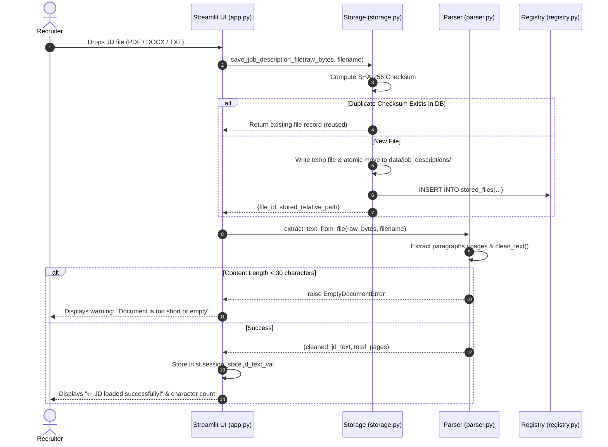
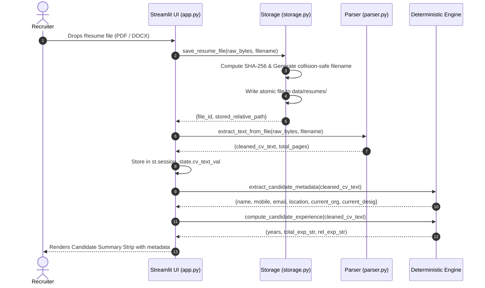
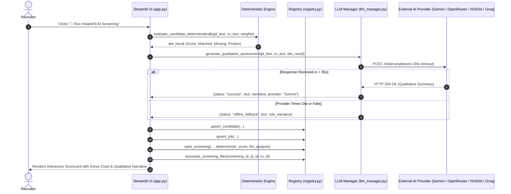
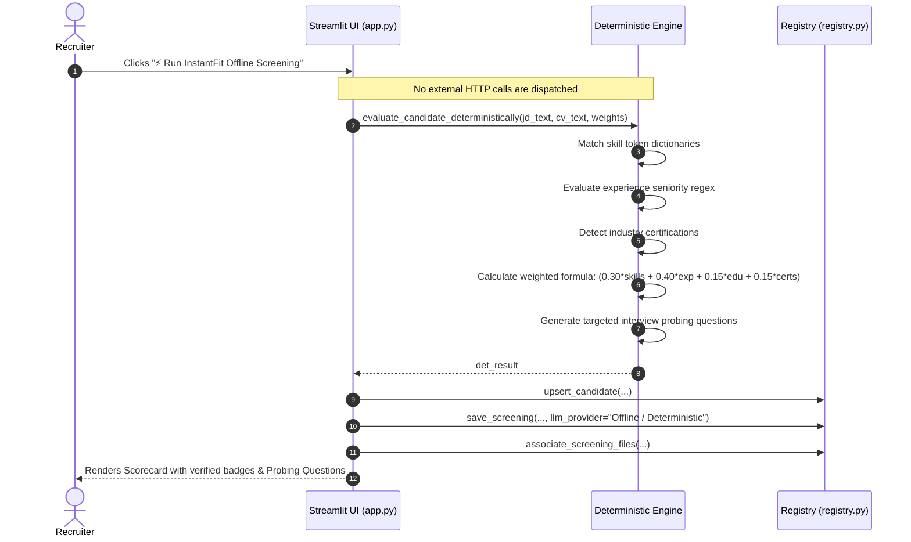
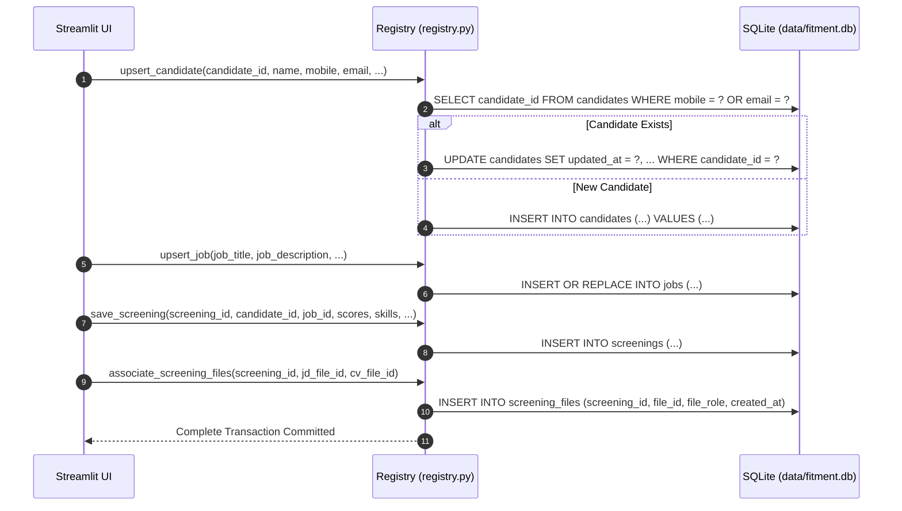
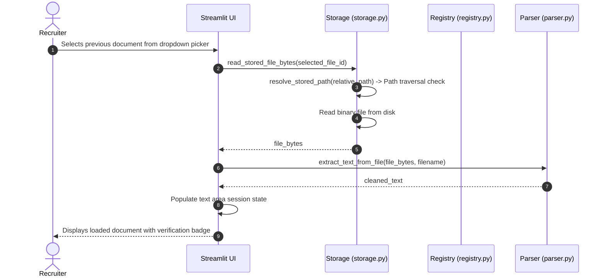
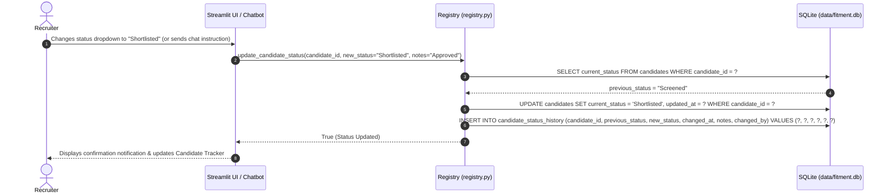
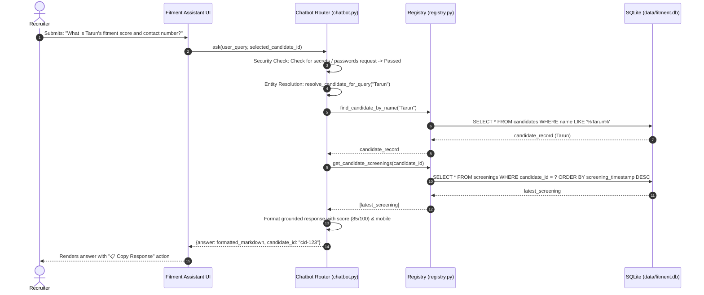
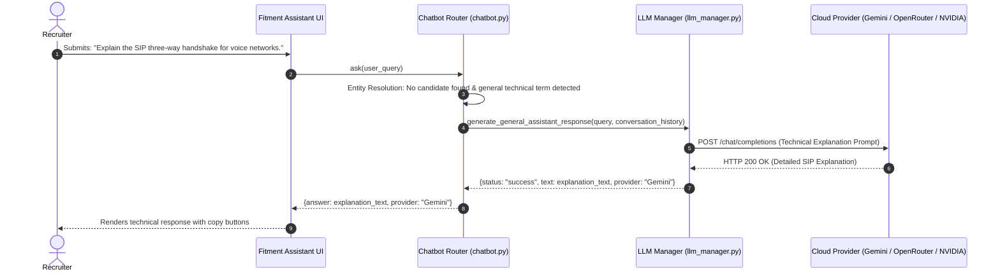
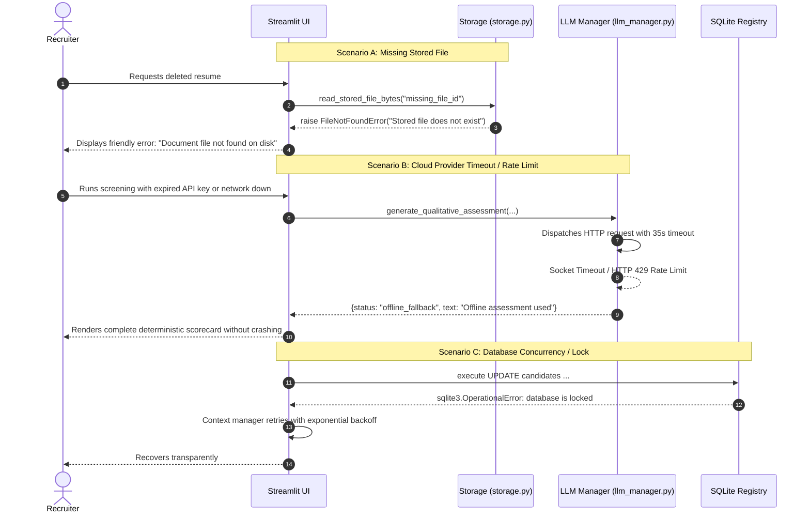

# ⏱️ Sequence Diagrams — FITMENT.AI Recruitment Intelligence Platform

> **Audience**: Solution Architects, Software Engineers, and QA Automation Engineers.  
> **Last Reviewed**: 2026-10-19  
> **Related Documents**: [`docs/architecture/data-flow.md`](file:///e:/Projects/resume-screening-agent/docs/architecture/data-flow.md), [`APPLICATION_ARCHITECTURE.md`](file:///e:/Projects/resume-screening-agent/APPLICATION_ARCHITECTURE.md).

This document details the exact execution order, synchronous calls, persistence actions, optional cloud steps, and failure paths for the 10 core operational workflows of FITMENT.AI.

---

## 1. Uploading and Parsing a Job Description

---

## 2. Uploading and Parsing a Candidate Resume

---

## 3. Running AI-Assisted Screening (Online Mode)

---

## 4. Running Deterministic Offline Screening

---

## 5. Persisting Candidate and Screening Results

---

## 6. Loading a Saved JD or Resume

---

## 7. Updating Recruitment Status & Transition History

---

## 8. Asking a Candidate-Specific Chatbot Question (Mode A)

---

## 9. Asking a Generic Technical Question through LLM (Mode B)

---

## 10. Handling Provider Failures, Missing Files & DB Errors

