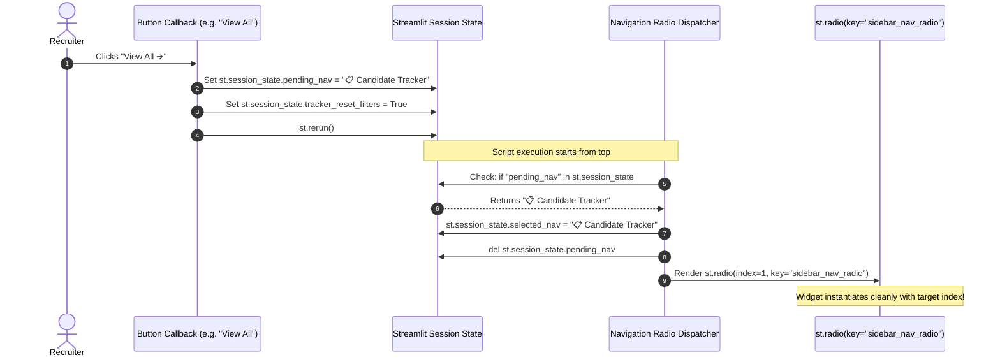

# 🗃️ State Management Architecture — FITMENT.AI Recruitment Intelligence Platform

> **Audience**: Frontend Engineers, Streamlit Developers, and System Architects.  
> **Last Reviewed**: 2026-10-19  
> **Primary Source Code**: [`app.py`](file:///e:/Projects/resume-screening-agent/app.py).

---

## 1. Streamlit Execution Model & State Fundamentals

Streamlit executes the Python script from top to bottom on every user interaction (button click, text change, file upload). Without careful state architecture, this execution model can lead to:
1. **Unintended State Reset**: Uploaded text or screening results disappearing upon clicking unrelated controls.
2. **Widget Lifecycle Collisions**: Modifying widget-bound keys after widget instantiation (`StreamlitWidgetAlreadyInstantiatedError`).
3. **Full-Page Flashing**: Continuous re-renders when updating real-time UI components like clocks or badges.

FITMENT.AI solves these challenges using a formalized **Session State Architecture** and **Isolated Component Fragments**.

---

## 2. Key Session State Variables Catalog

| State Key | Type | Default | Lifecycle & Scope |
| :--- | :--- | :--- | :--- |
| `selected_nav` | `str` | `"🏠 Screening Dashboard"` | Holds the active top-level view. Read before rendering navigation radio. |
| `pending_nav` | `Optional[str]` | `None` | Deferred navigation queue. Applied to `selected_nav` immediately before the sidebar radio widget is rendered. |
| `tracker_reset_filters` | `bool` | `False` | Trigger flag that resets candidate tracker search terms, status filters, and role dropdowns to show full unfiltered pool. |
| `workspace_initialized` | `bool` | `True` | Guarantees the dashboard begins cleanly without pre-loaded sample text. |
| `jd_text_val` | `str` | `""` | Preserves parsed or manually entered Job Description text across page refreshes. |
| `cv_text_val` | `str` | `""` | Preserves parsed or manually entered Candidate Resume text across page refreshes. |
| `active_screening_record`| `Optional[dict]` | `None` | Stores the active candidate's evaluation scorecard and JSON evidence. |
| `active_candidate_id` | `Optional[str]` | `None` | Global candidate focus identifier used to ground Fitment Assistant queries. |
| `chat_history` | `list[dict]` | `[]` | Multi-turn conversational history for the Fitment Assistant companion. |
| `provider_val_cache` | `dict` | `{}` | In-memory cache of external LLM connectivity health probes to avoid redundant network pings. |

---

## 3. The Safe Pending-Navigation Pattern (P0 Fix)

### The Problem: Widget Instantiation Collision
In Streamlit, every input widget associated with a `key` parameter binds to `st.session_state[key]`. If code attempts to assign a value to `st.session_state[key]` **after** the widget has already been instantiated in that script execution run, Streamlit throws:

```text
streamlit.errors.StreamlitWidgetAlreadyInstantiatedError:
st.session_state.sidebar_nav_radio cannot be modified after the widget with key sidebar_nav_radio is instantiated.
```

This previously crashed the portal whenever a recruiter clicked `"View All ➔"` in Recently Viewed Candidates (line 3329) or `"Open in Candidate Tracker"` in a candidate dialog.

### The Architectural Solution

FITMENT.AI decouples the **navigation trigger** from the **widget key assignment** using a deferred pending navigation queue:



### Implementation in Code ([`app.py`](file:///e:/Projects/resume-screening-agent/app.py))

```python
# Before widget instantiation (Sidebar Header):
if "pending_nav" in st.session_state and st.session_state.pending_nav:
    target_nav = st.session_state.pop("pending_nav")
    st.session_state.selected_nav = target_nav

# Compute index safely based on selected_nav
cur_nav_idx = nav_options.index(st.session_state.selected_nav) if st.session_state.selected_nav in nav_options else 0

chosen_nav = st.radio(
    "Navigation",
    options=nav_options,
    index=cur_nav_idx,
    label_visibility="collapsed",
    key="sidebar_nav_radio",
)
st.session_state.selected_nav = chosen_nav
```

All navigation trigger buttons throughout the application now use this pattern:
```python
# Safe navigation trigger pattern:
if st.button("View All ➔", key="view_all_candidates_btn"):
    st.session_state.pending_nav = "📋 Candidate Tracker"
    st.session_state.tracker_reset_filters = True
    st.rerun()
```

---

## 4. Isolated Component Fragments (`@st.fragment`)

### The Live IST Clock Architecture

The platform displays a real-time clock pill in the Welcome Banner formatted in Indian Standard Time (`DD Mon YYYY, HH:MM:SS IST`).

If implemented as a standard Streamlit script loop, re-rendering every 5 seconds would trigger a complete page re-evaluation, disrupting active text typing in the JD or resume input areas.

**Architectural Solution**:
FITMENT.AI isolates the clock pill inside a dedicated Streamlit fragment:

```python
@st.fragment(run_every="5s")
def _live_clock_fragment():
    """Isolated fragment: auto-refreshes the IST clock pill without re-rendering the page."""
    current_ist_str = registry.get_current_ist_str()
    st.markdown(
        f"""
        <div class="ist-clock-pill">
            <span class="clock-icon">🕒</span>
            <span class="clock-text">{current_ist_str}</span>
        </div>
        """,
        unsafe_allow_html=True,
    )
```

- **Scope of Re-run**: Only `_live_clock_fragment()` executes every 5 seconds.
- **Main Thread Impact**: Zero interference with the main screening workspace, text areas, or file uploader widgets.

---

## 5. Candidate Tracker Filter Reset State

When recruiters navigate to the Candidate Tracker via the `"View All ➔"` button in Recently Viewed Candidates, they expect to see the **entire unfiltered candidate pool**, rather than previous search filters.

This is managed via `st.session_state.tracker_reset_filters`:
```python
if st.session_state.get("tracker_reset_filters", False):
    st.session_state.tracker_search_query = ""
    st.session_state.tracker_status_filter = "All Statuses"
    st.session_state.tracker_job_filter = "All Roles"
    st.session_state.tracker_reset_filters = False
```
This guarantees an immediate, clean view of all registered candidates across the portal.
