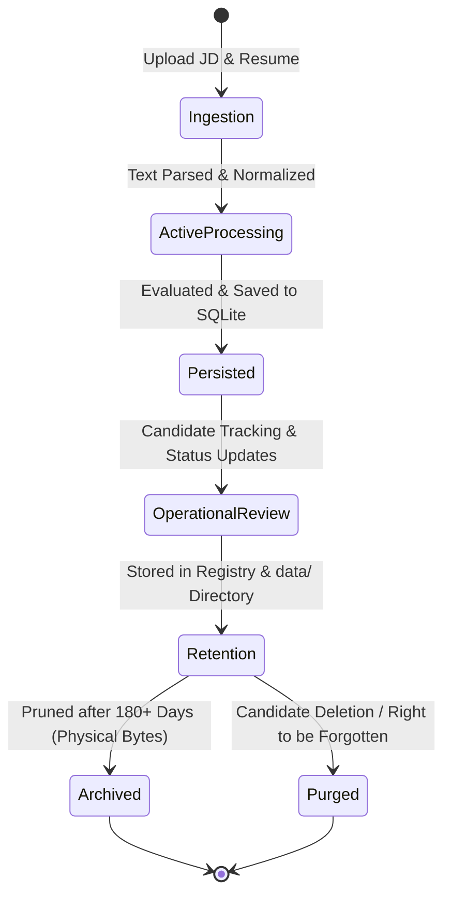

# ♻️ Data Lifecycle & Retention — FITMENT.AI

> **Audience**: Compliance Officers, Data Governance Leads, and System Administrators.  
> **Last Reviewed**: 2026-10-19  
> **Primary Source Code**: [`storage.py`](file:///e:/Projects/resume-screening-agent/storage.py), [`registry.py`](file:///e:/Projects/resume-screening-agent/registry.py).

---

## 1. End-to-End Data Lifecycle

Data in FITMENT.AI moves through five formalized phases, balancing immediate operational access with long-term auditability and privacy compliance:

---

## 2. Detailed Lifecycle Stages

### Phase 1: Ingestion & Creation
- **File Validation**: Files uploaded via Streamlit are restricted to verified extensions (`.pdf`, `.docx`, `.doc`, `.txt`) and capped at 15 MB.
- **Deduplication Check**: `storage.py` computes the SHA-256 hash. If duplicate bytes exist, the upload links to the existing file record, preventing redundant disk writes.
- **Extraction**: Plaintext is parsed, sanitized, and passed to the evaluation engine in volatile memory.

### Phase 2: Active Evaluation & Persistence
- **Entity Upsert**: Candidate profile attributes are registered in `candidates`. If a candidate re-applies or is re-screened, their contact details and experience are refreshed, but their initial `created_at` timestamp is permanently preserved.
- **Scorecard Recording**: The evaluation outcome is recorded in `screenings` along with JSON-serialized competency evidence, missing skills, and interview probing questions.
- **Junction Binding**: `screening_files` binds the screening to the physical file IDs.

### Phase 3: Operational Pipeline Management
- **Stage Transitions**: Recruiters advance candidates across the 11 recruitment stages (`New` $\rightarrow$ `Screened` $\rightarrow$ `Shortlisted` $\rightarrow$ `Interview Scheduled` $\rightarrow$ `Joined`, etc.).
- **Audit Immutability**: Every transition creates an immutable record in `candidate_status_history` logging prior status, updated status, timestamp, recruiter notes, and changing actor.

### Phase 4: Retention & Storage Pruning
- **Relational Longevity**: Candidate profiles and screening history remain in `fitment.db` indefinitely to enable longitudinal hiring analytics and candidate re-engagement.
- **Physical File Pruning**: Resumes and JDs older than corporate retention policies (e.g. 180 days) can be pruned from disk using `storage.delete_stored_file()` without breaking candidate profile records.

### Phase 5: Deletion & Right to Be Forgotten (GDPR / Privacy Compliance)
- When an enterprise candidate exercises their Right to Erasure:
  1. **Relational Cascade**: Deleting a candidate record (`DELETE FROM candidates WHERE candidate_id = ?`) automatically cascades via SQLite `ON DELETE CASCADE` to delete all associated screenings, status histories, follow-ups, and junction rows.
  2. **Physical File Wipe**: Associated resume files are deleted from `data/resumes/` using `storage.delete_saved_resume(file_id)`.
  3. **Audit Verification**: A zero-trace verification ensures no orphan records or leaked PII remain in the database.
