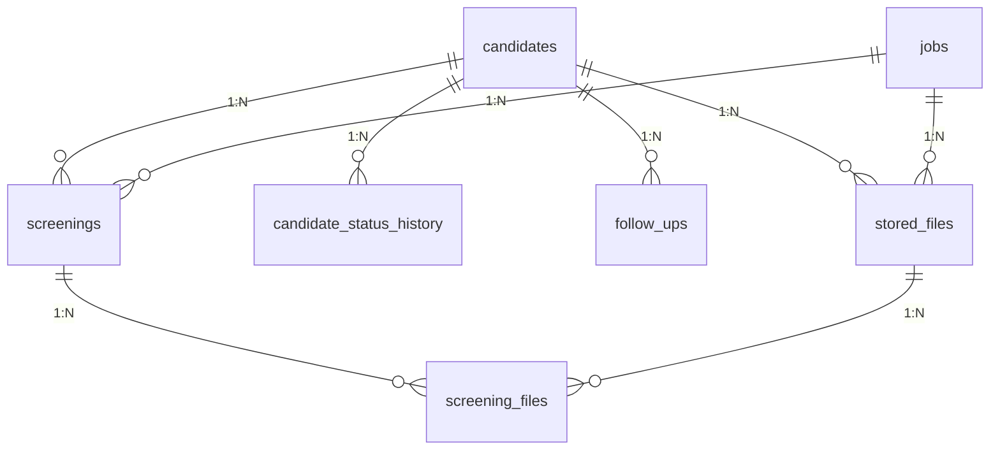

# 🗄️ Database Schema Reference — FITMENT.AI

> **Audience**: Database Administrators, Backend Engineers, and Security Auditors.  
> **Last Reviewed**: 2026-10-19  
> **Primary Source Code**: [`registry.py`](file:///e:/Projects/resume-screening-agent/registry.py).

---

## 1. Relational Database Overview

FITMENT.AI stores all persistent entities in a local SQLite 3 database located at `data/fitment.db`. The database operates with `PRAGMA foreign_keys = ON;` and implements 7 normalized tables to guarantee referential integrity and audit compliance.

---

## 2. Table Specifications

### 2.1 `candidates` Table
Maintains unique candidate identities and normalized profile attributes.

| Column Name | SQL Type | Nullable | Default | Description |
| :--- | :--- | :--- | :--- | :--- |
| `candidate_id` | `TEXT` | No | *(PK)* | 8-character unique alphanumeric identifier. |
| `name` | `TEXT` | No | — | Candidate full name. |
| `mobile` | `TEXT` | Yes | `'Not available in CV'` | E.164 normalized mobile phone number. |
| `email` | `TEXT` | Yes | `'Not Specified'` | Contact email address. |
| `location` | `TEXT` | Yes | `'Not Specified'` | City / State / Country location. |
| `current_organization`| `TEXT` | Yes | `'Not Detected'` | Detected current employer. |
| `current_designation` | `TEXT` | Yes | `'Not Detected'` | Detected current job title. |
| `previous_organizations`| `TEXT` | Yes | `'[]'` | JSON array of past employers. |
| `education` | `TEXT` | Yes | `'Not Specified'` | Highest detected educational credentials. |
| `certifications` | `TEXT` | Yes | `'[]'` | JSON array of verified vendor accreditations. |
| `total_experience` | `TEXT` | Yes | `'Not Detected'` | Formatted total years of professional experience. |
| `relevant_experience`| `TEXT` | Yes | `'Not Detected'` | Formatted domain-relevant experience. |
| `resume_reference` | `TEXT` | Yes | `''` | Original uploaded resume filename. |
| `current_status` | `TEXT` | Yes | `'Screened'` | Active stage across 11 recruitment stages. |
| `created_at` | `TEXT` | No | — | ISO-8601 registration timestamp. |
| `updated_at` | `TEXT` | No | — | ISO-8601 last-update timestamp. |

**Indexes**:
- `idx_candidates_name` ON `candidates(name)`
- `idx_candidates_email` ON `candidates(email)`
- `idx_candidates_mobile` ON `candidates(mobile)`
- `idx_candidates_status` ON `candidates(current_status)`
- `idx_candidates_org` ON `candidates(current_organization)`
- `idx_candidates_desig` ON `candidates(current_designation)`

---

### 2.2 `jobs` Table
Stores job requisitions, descriptions, and required skill profiles.

| Column Name | SQL Type | Nullable | Default | Description |
| :--- | :--- | :--- | :--- | :--- |
| `job_id` | `TEXT` | No | *(PK)* | 8-character unique job identifier. |
| `job_title` | `TEXT` | No | — | Requisition role title. |
| `job_description` | `TEXT` | No | — | Clean plain text of target Job Description. |
| `required_skills` | `TEXT` | Yes | `'[]'` | JSON array of mandatory competencies. |
| `preferred_skills`| `TEXT` | Yes | `'[]'` | JSON array of bonus competencies. |
| `min_experience` | `REAL` | Yes | `0` | Minimum required experience in years. |
| `created_at` | `TEXT` | No | — | ISO-8601 creation timestamp. |

**Indexes**:
- `idx_jobs_title` ON `jobs(job_title)`

---

### 2.3 `screenings` Table
Stores individual candidate screening events and scorecard outcomes.

| Column Name | SQL Type | Nullable | Default | Description |
| :--- | :--- | :--- | :--- | :--- |
| `screening_id` | `TEXT` | No | *(PK)* | 8-character unique screening event ID. |
| `candidate_id` | `TEXT` | No | — | FK $\rightarrow$ `candidates(candidate_id)` ON DELETE CASCADE. |
| `job_id` | `TEXT` | No | — | FK $\rightarrow$ `jobs(job_id)` ON DELETE CASCADE. |
| `screening_timestamp`| `TEXT` | No | — | ISO-8601 timestamp in IST. |
| `deterministic_score`| `INTEGER`| No | — | Authoritative fitment score (0–100). |
| `skills_score` | `INTEGER`| Yes | `0` | Technical competency sub-score (0–100). |
| `exp_score` | `INTEGER`| Yes | `0` | Seniority depth sub-score (0–100). |
| `cert_score` | `INTEGER`| Yes | `0` | Accreditations sub-score (0–100). |
| `matched_skills` | `TEXT` | Yes | `'[]'` | JSON array of matched competencies. |
| `missing_skills` | `TEXT` | Yes | `'[]'` | JSON array of missing required skills. |
| `verdict` | `TEXT` | No | — | `Strong Fit` \| `Moderate Fit` \| `Weak Fit`. |
| `recommendation` | `TEXT` | No | — | Authoritative recruiter recommendation. |
| `evidence` | `TEXT` | Yes | `'{}'` | JSON object of sentence-level evidence snippets. |
| `interview_questions`| `TEXT` | Yes | `'[]'` | JSON array of targeted probing questions. |
| `llm_analysis` | `TEXT` | Yes | `''` | Qualitative narrative synthesis text. |
| `llm_provider` | `TEXT` | Yes | `'Offline / Deterministic'` | AI provider used or Offline indicator. |
| `llm_model` | `TEXT` | Yes | `'None'` | Model name (e.g. `gemini-3.5-flash-lite`). |
| `engine_version` | `TEXT` | Yes | `'2.0.0'` | Screening engine algorithm version. |

**Indexes**:
- `idx_screenings_candidate` ON `screenings(candidate_id)`
- `idx_screenings_job` ON `screenings(job_id)`
- `idx_screenings_score` ON `screenings(deterministic_score)`

---

### 2.4 `candidate_status_history` Table
Immutable chronological audit log of all recruitment stage transitions.

| Column Name | SQL Type | Nullable | Default | Description |
| :--- | :--- | :--- | :--- | :--- |
| `id` | `INTEGER`| No | *(PK Auto)*| Sequential record ID. |
| `candidate_id` | `TEXT` | No | — | FK $\rightarrow$ `candidates(candidate_id)` ON DELETE CASCADE. |
| `screening_id` | `TEXT` | Yes | `NULL` | Associated screening ID if applicable. |
| `previous_status`| `TEXT` | Yes | `NULL` | Prior stage (e.g. `'Screened'`). |
| `new_status` | `TEXT` | No | — | Updated stage (e.g. `'Shortlisted'`). |
| `changed_at` | `TEXT` | No | — | ISO-8601 transition timestamp. |
| `notes` | `TEXT` | Yes | `''` | Recruiter rationale or interview notes. |
| `changed_by` | `TEXT` | Yes | `'Recruiter'`| User or automated process identifier. |

---

### 2.5 `follow_ups` Table
Recruiter task scheduling and milestone deadlines.

| Column Name | SQL Type | Nullable | Default | Description |
| :--- | :--- | :--- | :--- | :--- |
| `id` | `INTEGER`| No | *(PK Auto)*| Sequential record ID. |
| `candidate_id` | `TEXT` | No | — | FK $\rightarrow$ `candidates(candidate_id)` ON DELETE CASCADE. |
| `screening_id` | `TEXT` | Yes | `NULL` | Associated screening ID. |
| `follow_up_date` | `TEXT` | No | — | Target deadline date (`YYYY-MM-DD`). |
| `status` | `TEXT` | Yes | `'pending'` | `'pending'` \| `'completed'`. |
| `notes` | `TEXT` | Yes | `''` | Recruiter follow-up instructions. |
| `created_at` | `TEXT` | No | — | ISO-8601 creation timestamp. |

---

### 2.6 `stored_files` Table
Catalogs physical files saved in the local filesystem (`data/`).

| Column Name | SQL Type | Nullable | Default | Description |
| :--- | :--- | :--- | :--- | :--- |
| `file_id` | `TEXT` | No | *(PK)* | 8-character unique file identifier. |
| `file_type` | `TEXT` | No | — | `'job_description'` \| `'resume'`. |
| `original_filename`| `TEXT`| No | — | Original filename at upload. |
| `stored_relative_path`| `TEXT`| No | — | Relative path (e.g. `data/resumes/cv_...pdf`). |
| `stored_path` | `TEXT` | Yes | `NULL` | Migration redundant path. |
| `file_role` | `TEXT` | Yes | `NULL` | Role tag (`'jd'` \| `'resume'`). |
| `file_size` | `INTEGER`| No | — | File size in bytes. |
| `sha256_hash` | `TEXT` | No | — | Cryptographic SHA-256 digest for deduplication. |
| `upload_timestamp`| `TEXT` | No | — | ISO-8601 upload timestamp. |
| `candidate_id` | `TEXT` | Yes | `NULL` | FK $\rightarrow$ `candidates(candidate_id)` ON DELETE SET NULL. |
| `job_id` | `TEXT` | Yes | `NULL` | FK $\rightarrow$ `jobs(job_id)` ON DELETE SET NULL. |
| `screening_id` | `TEXT` | Yes | `NULL` | Associated screening ID. |

---

### 2.7 `screening_files` (Junction Table)
Enables many-to-many associations between screenings and stored files.

| Column Name | SQL Type | Nullable | Default | Description |
| :--- | :--- | :--- | :--- | :--- |
| `id` | `INTEGER`| No | *(PK Auto)*| Sequential junction record ID. |
| `screening_id` | `TEXT` | No | — | FK $\rightarrow$ `screenings(screening_id)` ON DELETE CASCADE. |
| `file_id` | `TEXT` | No | — | FK $\rightarrow$ `stored_files(file_id)` ON DELETE CASCADE. |
| `file_role` | `TEXT` | No | — | File role in screening (`'jd'` \| `'resume'`). |
| `created_at` | `TEXT` | No | — | ISO-8601 creation timestamp. |

---

## 3. Schema Migrations Strategy

FITMENT.AI employs safe, idempotent schema migrations executed automatically inside `init_db()`:
1. Inspects active table metadata using `PRAGMA table_info(stored_files);`.
2. Checks for newly introduced columns (e.g. `stored_path`, `file_role`).
3. Executes `ALTER TABLE ... ADD COLUMN` if missing.
4. Updates existing records with sensible defaults.
5. Guarantees that older `fitment.db` files upgrade seamlessly without requiring data wipes or manual SQL scripts.
