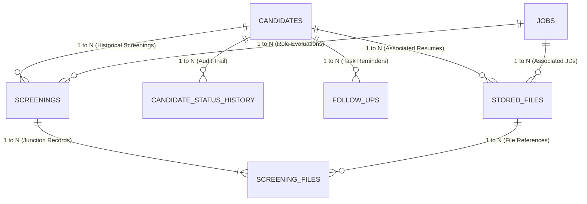
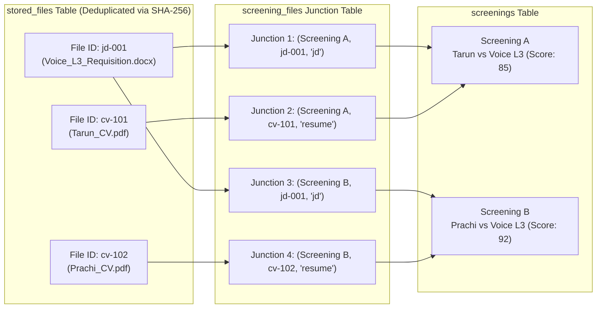

# 🔗 Entity Relationships & Junction Model — FITMENT.AI

> **Audience**: Database Designers, Systems Integrators, and Backend Engineers.  
> **Last Reviewed**: 2026-10-19  
> **Primary Source Code**: [`registry.py`](file:///e:/Projects/resume-screening-agent/registry.py), [`storage.py`](file:///e:/Projects/resume-screening-agent/storage.py).

---

## 1. Relational Entity Overview

FITMENT.AI models the talent acquisition pipeline using a relational entity model. It balances strict normalization with high-speed read performance for candidate dashboards and conversational retrieval.

---

## 2. Cardinality Analysis

| Relationship | Cardinality | Business Meaning | Constraint Rule |
| :--- | :--- | :--- | :--- |
| **`candidates` $\rightarrow$ `screenings`** | $1 : N$ | A single candidate can be screened multiple times across different dates or against different job descriptions. | `ON DELETE CASCADE`: Deleting a candidate removes their evaluation history. |
| **`jobs` $\rightarrow$ `screenings`** | $1 : N$ | A single job requisition can evaluate dozens or hundreds of candidate applicants. | `ON DELETE CASCADE`: Deleting a job removes associated screening runs. |
| **`candidates` $\rightarrow$ `candidate_status_history`** | $1 : N$ | Every pipeline stage transition generates an immutable chronological audit row. | `ON DELETE CASCADE`. |
| **`candidates` $\rightarrow$ `follow_ups`** | $1 : N$ | A candidate can have multiple scheduled follow-up tasks and deadlines over their recruitment lifecycle. | `ON DELETE CASCADE`. |
| **`screenings` $\leftrightarrow$ `stored_files`** | $M : N$ | Screenings connect to stored files via the `screening_files` junction table. | Enforces referential integrity while permitting file reuse. |

---

## 3. The Many-to-Many Screening Files Junction Model

### The Problem in Traditional Recruitment Systems
In naive designs, a screening table contains two string columns: `jd_path` and `resume_path`. This causes major limitations:
1. **Redundant Storage**: If 50 candidates apply for the same "Senior Voice Engineer" role, the JD file is saved 50 times, consuming disk space.
2. **Broken File Tracing**: If a JD is modified or updated, historical screenings lose track of the exact original document version evaluated.
3. **Collision Vulnerability**: Resumes with identical filenames (e.g. `Resume.pdf`) overwrite each other.

### The FITMENT.AI Solution
FITMENT.AI separates **Physical File Storage** from **Screening Events** using the `screening_files` junction table:

### Key Architectural Benefits
- **Zero Storage Bloat**: `Voice_L3_Requisition.docx` is stored once on disk. Both Screening A and Screening B link to the identical `file_id`.
- **Bidirectional Traceability**:
  - From a candidate screening, you can immediately retrieve the exact source JD and resume bytes (`registry.get_screening_files(screening_id)`).
  - From a stored JD file, you can immediately list every candidate ever evaluated against that exact document version.
- **Resilient File Deletion**: If a single screening is deleted, the master JD file remains safely available for other candidates.
