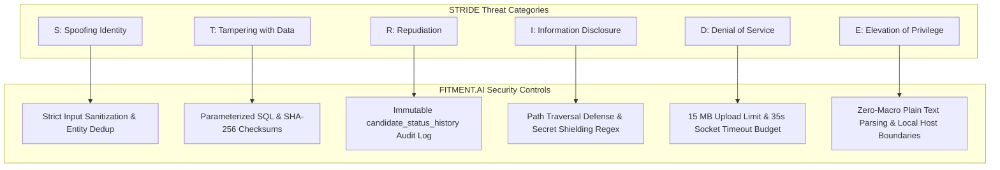

# 🛡️ Privacy & Threat Model (STRIDE) — FITMENT.AI

> **Audience**: Chief Information Security Officers (CISO), Security Architects, and Compliance Teams.  
> **Last Reviewed**: 2026-10-19  
> **Primary Source Code**: [`SECURITY.md`](file:///e:/Projects/resume-screening-agent/SECURITY.md), [`storage.py`](file:///e:/Projects/resume-screening-agent/storage.py), [`chatbot.py`](file:///e:/Projects/resume-screening-agent/chatbot.py), [`registry.py`](file:///e:/Projects/resume-screening-agent/registry.py).

---

## 1. Candidate Privacy & Personally Identifiable Information (PII)

Recruitment platforms process sensitive personal and professional data, including candidate full names, personal phone numbers, private email addresses, career history, compensation indicators, and hiring manager assessments.

FITMENT.AI enforces strict privacy protections across the data lifecycle:
1. **Local-First Boundary**: Candidate resumes and evaluation databases are stored on local host storage (`data/`) and are never sent to third-party multi-tenant databases.
2. **Git Version Control Shielding**: The repository `.gitignore` explicitly blocks all candidate files (`data/*.pdf`, `data/*.docx`, `data/*.txt`, `data/resumes/*`), SQLite database files (`*.db`, `*.sqlite`), and environment configuration (`.env`).
3. **Payload Minimization**: When optional generative AI summaries are invoked, the platform transmits only extracted competency keywords and short evidence sentences; it **never transmits raw binary PDF resumes** to cloud providers.

---

## 2. STRIDE Threat Model & Mitigations

### Detailed STRIDE Matrix

| Threat Category | Potential Attack Vector | Platform Impact | Implemented Mitigation | Verification Test |
| :--- | :--- | :--- | :--- | :--- |
| **S: Spoofing** | Candidate impersonation or forging candidate ID. | Duplicate records or misattributed evaluations. | Primary candidate resolution matches unique normalized mobile (`normalize_phone`) and email (`normalize_email`). | [`tests/test_portal_upgrades.py`](file:///e:/Projects/resume-screening-agent/tests/test_portal_upgrades.py) |
| **T: Tampering** | Manipulating SQL queries via malicious resume text (SQL Injection). | Database corruption or data extraction. | **100% Parameterized SQL**: Every query in `registry.py` uses SQLite `?` placeholders. Zero string formatting (`f"..."`) in SQL statements. | Code review & SQLi regression tests. |
| **R: Repudiation** | Recruiter denying they rejected a candidate or changed a stage. | Loss of regulatory audit compliance. | **Immutable Status History**: Every change writes an immutable audit record in `candidate_status_history` capturing timestamp, prior status, new status, recruiter name, and notes. | [`tests/test_portal_upgrades.py`](file:///e:/Projects/resume-screening-agent/tests/test_portal_upgrades.py) |
| **I: Information Disclosure** | 1. Path traversal via filename (`../../etc/passwd`). 2. Prompt injection asking chatbot to reveal `GEMINI_API_KEY`. | Exfiltration of system secrets or host files. | 1. **Path Traversal Shield**: `storage.resolve_stored_path()` verifies `os.path.commonpath([base_dir, target]) == base_dir`. 2. **Secret Shielding**: `chatbot.py` blocks queries seeking secrets, environment variables, or passwords. | [`tests/test_file_storage.py`](file:///e:/Projects/resume-screening-agent/tests/test_file_storage.py), [`tests/test_critical_fixes.py`](file:///e:/Projects/resume-screening-agent/tests/test_critical_fixes.py) |
| **D: Denial of Service** | 1. Uploading a 500 MB file to exhaust RAM. 2. Hanging cloud LLM socket. | Server freeze or process crash. | 1. Streamlit enforces `maxUploadSize = 15` MB. 2. `llm_manager.py` enforces a strict 35.0-second socket timeout budget (`DEFAULT_TIMEOUT = 35.0`). | Network stress tests & timeout unit tests. |
| **E: Elevation of Privilege** | Malicious macros or embedded scripts in PDF/DOCX files. | Remote code execution on host server. | Parsers (`pypdf`, `python-docx`) exclusively extract text tokens; no embedded macros, ActiveX objects, or scripts are ever executed. | Document parser security tests. |
