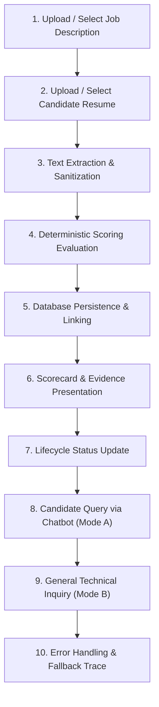

# 🚶 End-to-End Walkthrough — FITMENT.AI Recruitment Intelligence Platform

> **Audience**: Technical Recruiter Admins, Onboarding Developers, and Solution Architects.  
> **Last Reviewed**: 2026-10-19  
> **Primary Source Code**: [`app.py`](file:///e:/Projects/resume-screening-agent/app.py), [`deterministic_engine.py`](file:///e:/Projects/resume-screening-agent/deterministic_engine.py), [`registry.py`](file:///e:/Projects/resume-screening-agent/registry.py).

This document follows a realistic, complete candidate screening lifecycle through the FITMENT.AI platform, detailing the exact function calls, inputs, outputs, database transactions, and potential failure points at each step.

---

## Complete Workflow Overview



---

## Step 1: Loading a Job Description

- **User Action**: The recruiter drags and drops `Voice_L3_Lead_JD.docx` into the Job Description panel (or selects a previously saved JD from the reusable picker).
- **Code Entry Point**: [`app.py`](file:///e:/Projects/resume-screening-agent/app.py) around line 1756.
- **Key Function Call**:
  ```python
  jd_info = storage.save_job_description_file(raw_bytes, filename="Voice_L3_Lead_JD.docx")
  ```
- **Inputs**: Raw byte stream, original filename string.
- **Storage Operation**: `storage.py` computes the SHA-256 hash. If new, it writes atomic bytes to `data/job_descriptions/jd_Voice_L3_Lead_JD_a1b2c3d4.docx` and logs the record in the `stored_files` SQLite table.
- **Possible Failure**: File exceeds 15 MB limit $\rightarrow$ Streamlit rejects the upload with an explicit file size alert.

---

## Step 2: Loading a Candidate Resume

- **User Action**: The recruiter uploads `Tarun_Voice_Architect_CV.pdf` into the Candidate Resume panel.
- **Code Entry Point**: [`app.py`](file:///e:/Projects/resume-screening-agent/app.py) around line 1860.
- **Key Function Call**:
  ```python
  cv_info = storage.save_resume_file(raw_bytes, filename="Tarun_Voice_Architect_CV.pdf")
  ```
- **Inputs**: Raw byte stream, original filename string.
- **Storage Operation**: Writes atomic bytes to `data/resumes/cv_Tarun_Voice_Architect_CV_e5f6g7h8.pdf` and logs in `stored_files`.
- **Possible Failure**: Corrupted binary file $\rightarrow$ `parser.extract_text_from_file()` catches `PDFParsingError` and alerts the recruiter without crashing.

---

## Step 3: Text Parsing & Metadata Discovery

- **Code Entry Point**: [`parser.py:extract_text_from_file()`](file:///e:/Projects/resume-screening-agent/parser.py).
- **Execution**:
  - `pypdf.PdfReader` iterates over PDF pages and extracts raw text chunks.
  - `clean_text()` strips non-printable characters and normalizes whitespace.
  - [`deterministic_engine.extract_candidate_metadata()`](file:///e:/Projects/resume-screening-agent/deterministic_engine.py) extracts:
    - Name: `Tarun`
    - Mobile: `+91-9876543210`
    - Email: `tarun@example.com`
    - Current Organization: `Cisco Systems`
    - Designation: `Technical Consulting Engineer`
  - `compute_candidate_experience()` extracts `15 Years` total experience, filtering out educational graduation dates.
- **UI Output**: Renders the Candidate Summary Strip displaying candidate name, mobile, email, organization, designation, and experience.

---

## Step 4: Running Deterministic Screening

- **User Action**: The recruiter clicks `"🚀 Run InstantFit AI Screening"`.
- **Code Entry Point**: [`deterministic_engine.evaluate_candidate_deterministically()`](file:///e:/Projects/resume-screening-agent/deterministic_engine.py).
- **Algorithm Execution**:
  1. Tokenizes mandatory JD skills: `SIP`, `Cisco CUCM`, `VoIP`, `Session Border Controller (SBC)`, `Wireshark`, `Python`.
  2. Matches candidate resume tokens against skill dictionaries.
  3. Verifies certifications: detects `CCNA`, `CCNP Collaboration`, `CCIE Written`.
  4. Computes weighted mathematical fitment score:
     $$\text{Score} = (0.30 \times 90) + (0.40 \times 95) + (0.15 \times 80) + (0.15 \times 100) = 87$$
  5. Assigns verdict: **Strong Fit** ($\ge 75$, Green).
  6. Generates 3 targeted technical interview probing questions.
- **Outputs**: Complete structured evaluation dictionary.

---

## Step 5: Database Registration & Linking

- **Code Entry Point**: [`registry.py`](file:///e:/Projects/resume-screening-agent/registry.py).
- **SQL Transactions**:
  1. `upsert_candidate(...)`: Inserts or updates candidate in `candidates` table.
  2. `upsert_job(...)`: Registers job title and description in `jobs` table.
  3. `save_screening(...)`: Records score (87), verdict, JSON skills, evidence snippets, and interview probes in `screenings`.
  4. `associate_screening_files(...)`: Inserts 2 rows into `screening_files` linking the `screening_id` to the JD `file_id` and CV `file_id`.
- **Database Outcome**: Relational records committed safely with foreign keys enforced.

---

## Step 6: Scorecard & Evidence Presentation

- **Code Entry Point**: [`app.py`](file:///e:/Projects/resume-screening-agent/app.py) line 2200+.
- **UI Elements Rendered**:
  - **Donut Chart**: Circular SVG gauge displaying `87/100` and `Strong Fit`.
  - **Category Sub-Scores**: Skills (90%), Experience (95%), Education (80%), Certifications (100%).
  - **Evidence Pills**: Green pills for matched skills with expandable sentence-level resume quotes.
  - **Missing Skills**: Amber/Red pills for competencies not verified in the CV.
  - **Targeted Probes**: Formatted technical questions tailored to the candidate's experience.
  - **Dossier Export**: One-click download button generating `Candidate_Fitment_Dossier_Tarun.md`.

---

## Step 7: Updating Recruitment Status

- **User Action**: Recruiter selects `"Shortlisted"` from the status dropdown and clicks Update.
- **Code Entry Point**: [`registry.update_candidate_status()`](file:///e:/Projects/resume-screening-agent/registry.py).
- **SQL Execution**:
  ```sql
  UPDATE candidates SET current_status = 'Shortlisted', updated_at = ? WHERE candidate_id = ?;
  INSERT INTO candidate_status_history (candidate_id, previous_status, new_status, changed_at, notes, changed_by)
  VALUES (?, 'Screened', 'Shortlisted', ?, 'Candidate approved by recruiter', 'Recruiter');
  ```
- **Result**: Immediate confirmation toast; candidate status updated in the database and Candidate Tracker.

---

## Step 8: Conversational Candidate Lookup (Mode A)

- **User Action**: Recruiter opens the Fitment Assistant and types:
  > *"What is Tarun's contact number and when was he screened?"*
- **Code Entry Point**: [`chatbot.FitmentAssistant.ask()`](file:///e:/Projects/resume-screening-agent/chatbot.py).
- **Execution Flow**:
  1. Secret Shield checks for passwords $\rightarrow$ passed.
  2. Entity Resolution identifies `Tarun` $\rightarrow$ resolves `candidate_id`.
  3. Executes `registry.find_candidate_by_name("Tarun")` and `registry.get_candidate_screenings()`.
  4. Retrieves mobile `+91-9876543210` and screening timestamp in IST.
  5. Formats markdown response with client-side **`📋 Copy Response`** and **`📄 Copy Candidate Details`** buttons.

---

## Step 9: General Technical Inquiry (Mode B)

- **User Action**: Recruiter asks:
  > *"Explain SIP early media vs. regular call setup."*
- **Code Entry Point**: [`chatbot.py`](file:///e:/Projects/resume-screening-agent/chatbot.py) routing to [`llm_manager.generate_general_assistant_response()`](file:///e:/Projects/resume-screening-agent/llm_manager.py).
- **Execution Flow**:
  1. Entity resolution confirms no candidate is referenced; query matches technical terms.
  2. Outbound HTTPS request sent to active provider (e.g. Google Gemini or Groq).
  3. Clear, structured technical explanation returned in markdown.

---

## Step 10: Graceful Error Handling & Fallback Trace

- **Scenario**: The recruiter triggers AI screening while the internet connection is temporarily offline.
- **Execution Flow**:
  1. Deterministic scoring (Steps 3, 4, 5) completes 100% locally.
  2. LLM Manager dispatches HTTP request; catches `urllib.error.URLError` immediately.
  3. Activates offline fallback narrative automatically.
  4. The scorecard displays the mathematical score (87/100) and indicates `⚡ InstantFit Offline Screening Active`.
  5. **Zero crash, zero interruption.**
