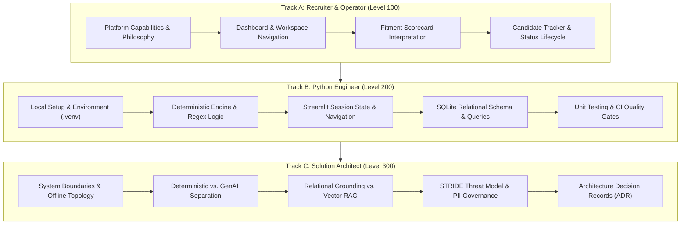

# 🗺️ Architecture Knowledge Map & Learning Roadmap — FITMENT.AI

> **Audience**: New Engineers, Solution Architects, Recruiter Admins, and Engineering Trainees.  
> **Last Reviewed**: 2026-10-19  
> **Primary Document Index**: [`docs/README.md`](file:///e:/Projects/resume-screening-agent/docs/README.md).

---

## 1. Learning Philosophy & Curriculum Overview

FITMENT.AI is engineered to be approachable yet deeply rigorous. To facilitate rapid onboarding and technical mastery, this knowledge map organizes the system into three progressive learning tracks:

---

## 2. Track A: Operator & Recruiter Curriculum (Level 100)

**Target Audience**: Technical Recruiters, Hiring Managers, Talent Acquisition Leads.  
**Prerequisites**: Basic understanding of technical hiring, resume reviewing, and web browsers.

### Learning Objectives
1. Understand why FITMENT.AI uses deterministic scoring rather than pure AI generation.
2. Master uploading Job Descriptions and candidate resumes in PDF and DOCX formats.
3. Interpret fitment scorecards, evidence snippets, and targeted interview probing questions.
4. Manage candidate pipeline stages across the 11 recruitment statuses.
5. Use the Fitment Assistant chat companion to quickly extract contact info and scores.

### Recommended Reading Order
1. [**README.md**](file:///e:/Projects/resume-screening-agent/README.md) — System introduction and feature tour.
2. [**Mental Models: 30-Second & Beginner Views**](file:///e:/Projects/resume-screening-agent/docs/learning/MENTAL_MODELS.md#1-the-30-second-mental-model-elevator-pitch) — Conceptual analogies.
3. [**End-to-End Walkthrough**](file:///e:/Projects/resume-screening-agent/docs/learning/END_TO_END_WALKTHROUGH.md) — Step-by-step screening workflow.
4. [**Recruitment Status Lifecycle**](file:///e:/Projects/resume-screening-agent/ARCHITECTURE.md#6-recruitment-status-lifecycle) — The 11 pipeline stages.

---

## 3. Track B: Software Developer Curriculum (Level 200)

**Target Audience**: Python Developers, Full-Stack Engineers, QA Automation Leads.  
**Prerequisites**: Python 3.10+, SQLite basics, Streamlit fundamentals, Regular Expressions.

### Learning Objectives
1. Set up a local development environment and run the test suite (`python -m unittest discover tests`).
2. Understand how `deterministic_engine.py` parses experience, matches skills, and scores candidates.
3. Master the safe deferred pending-navigation pattern in `app.py` to avoid widget errors.
4. Trace SQLite transactions, foreign keys, and indexes in `registry.py`.
5. Maintain and extend multi-provider integrations in `llm_manager.py`.

### Recommended Reading Order
1. [**APPLICATION_ARCHITECTURE.md**](file:///e:/Projects/resume-screening-agent/APPLICATION_ARCHITECTURE.md) — Module catalog and data contracts.
2. [**Codebase Tour**](file:///e:/Projects/resume-screening-agent/docs/learning/CODEBASE_TOUR.md) — Directory layout and execution pathways.
3. [**State Management Architecture**](file:///e:/Projects/resume-screening-agent/docs/architecture/state-management.md) — Session state and widget safety.
4. [**Sequence Diagrams**](file:///e:/Projects/resume-screening-agent/docs/architecture/sequence-diagrams.md) — Core execution sequence flows.
5. [**Testing Guide**](file:///e:/Projects/resume-screening-agent/docs/operations/testing-guide.md) — Unit test authoring and execution.

---

## 4. Track C: Solution Architect Curriculum (Level 300)

**Target Audience**: Enterprise Architects, AI Safety Officers, Security Reviewers, CTOs.  
**Prerequisites**: Distributed systems concepts, LLM architectures, threat modeling, data governance.

### Learning Objectives
1. Evaluate the architectural merits of Relational Database Grounding vs. Vector RAG.
2. Analyze the STRIDE threat model, PII protections, and path-traversal safeguards.
3. Review and defend the 8 Architecture Decision Records (ADRs).
4. Plan future enterprise extensions (ATS webhooks, SSO authentication, multi-region database clustering).

### Recommended Reading Order
1. [**ARCHITECTURE.md**](file:///e:/Projects/resume-screening-agent/ARCHITECTURE.md) — High-level solution design.
2. [**AI Architecture & Ecosystem**](file:///e:/Projects/resume-screening-agent/AI_ARCHITECTURE.md) — Deterministic vs. GenAI vs. Agentic.
3. [**Grounding and Retrieval**](file:///e:/Projects/resume-screening-agent/docs/ai/grounding-and-retrieval.md) — SQL vs. Vector RAG deep-dive.
4. [**Privacy & Threat Model**](file:///e:/Projects/resume-screening-agent/docs/data-and-security/privacy-and-threat-model.md) — STRIDE security evaluation.
5. [**Architecture Decision Records (ADR)**](file:///e:/Projects/resume-screening-agent/docs/architecture/architecture-decisions.md) — Tradeoff rationale.
