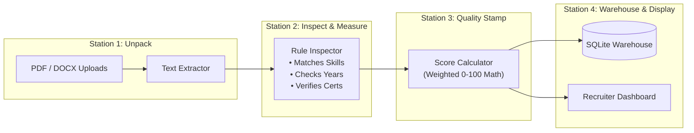
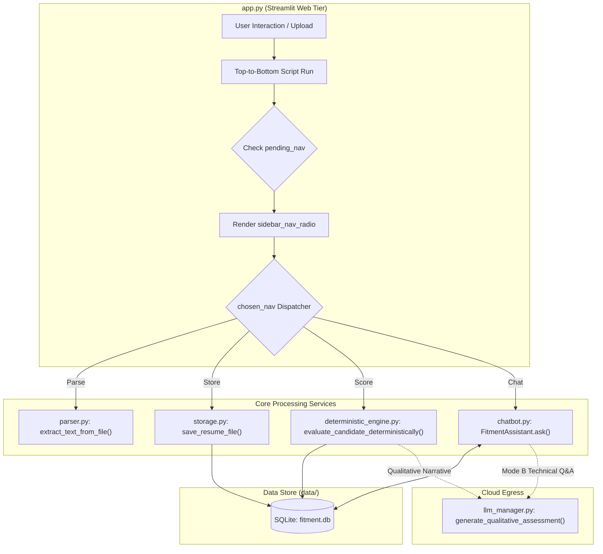
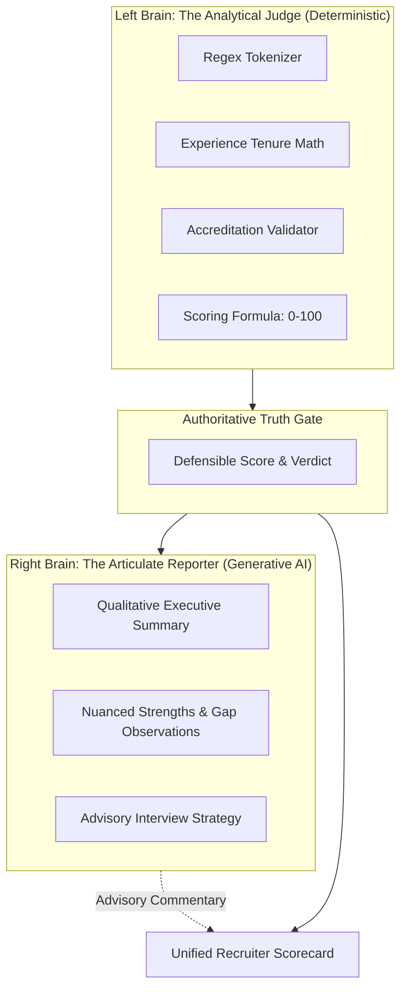
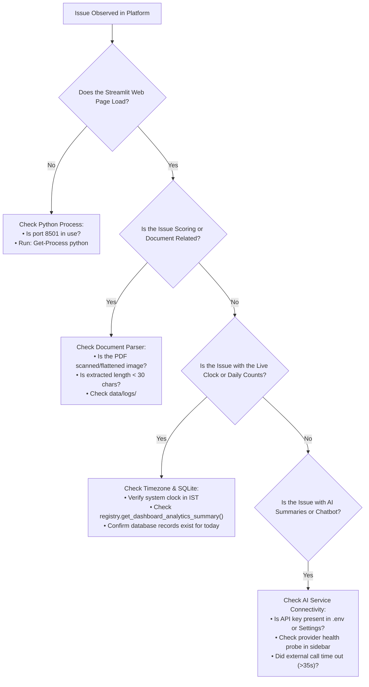
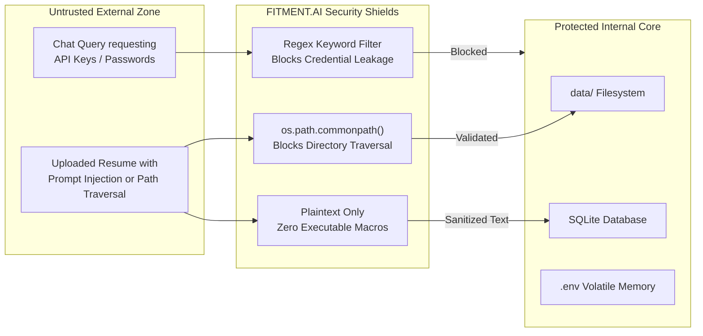

# 🧠 Progressive Mental Models — FITMENT.AI Recruitment Intelligence Platform

> **Audience**: All Engineers, Architects, Recruiters, and Technical Leaders.  
> **Last Reviewed**: 2026-10-19  
> **Core Companion Docs**: [`docs/learning/KNOWLEDGE_MAP.md`](file:///e:/Projects/resume-screening-agent/docs/learning/KNOWLEDGE_MAP.md), [`APPLICATION_ARCHITECTURE.md`](file:///e:/Projects/resume-screening-agent/APPLICATION_ARCHITECTURE.md).

---

## 1. The 30-Second Mental Model (Elevator Pitch)

> **Analogy**: *Think of FITMENT.AI as an expert technical interviewer sitting right beside you. Instead of guessing or hallucinating candidate scores, it uses a precise mathematical ruler to measure exact skill overlap and experience depth, stores the results in an audit-ready ledger, and lets you query candidate details through a smart conversational companion.*

### The Core Essence
FITMENT.AI takes a Job Description and a Candidate Resume, extracts verified facts (skills, experience, certifications), calculates a mathematically reproducible fitment score (0–100), saves the evaluation in a local SQLite database, and optionally enriches the report with qualitative AI executive summaries—all while operating 100% reliably offline.

---

## 2. The Beginner Mental Model: The Assembly Line

> **Analogy**: *An automated factory assembly line where raw materials enter at one end, pass through inspection stations, get stamped with a quality score, and are packaged into an executive report.*



### Key Beginner Concepts
- **Inputs**: Two text or document files (Job Description + Resume).
- **Processing**: The system searches for exact keywords, calculates years of experience, and validates certifications.
- **Outputs**:
  - A numerical score from 0 to 100.
  - A color-coded verdict: **Strong Fit** (Green $\ge 75$), **Moderate Fit** (Amber $55–74$), **Weak Fit** (Red $< 55$).
  - A checklist of matched skills and missing competency gaps.
  - 3 targeted technical interview questions.

> [!TIP]
> **Remember This**: FITMENT.AI never guesses your candidate's score. The score is calculated using pure math, meaning the same resume always gets the exact same score.

---

## 3. The Developer Mental Model: Functions, State & Schema

For developers writing code in Python, Streamlit, and SQLite:



### Developer Invariants
1. **Streamlit Script Lifecycle**: Every button click re-executes the file from line 1. State must be preserved in `st.session_state`.
2. **Widget Key Protection**: Never assign to a widget's session state key after instantiation. Always set `st.session_state.pending_nav` and call `st.rerun()`.
3. **Database Parameterization**: Never use string interpolation in SQL. Every query uses `?` placeholders.
4. **Isolated Refresh**: Real-time clocks run inside `@st.fragment(run_every="5s")` to prevent full-page script re-runs.

---

## 4. The Solution Architect Mental Model: Boundaries, Ownership & Invariants

```mermaid
flowchart TD
    subgraph TrustBoundary ["Local Trust Perimeter (Workstation / On-Premise Host)"]
        subgraph WebProcess ["Process 1: Web Application"]
            Streamlit["Streamlit UI Server (:8501)"]
            Engine["Deterministic Engine Core"]
            AssistantRouter["Intent Router & Dispatcher"]
        end

        subgraph LocalDisk ["Durable Local Storage (data/)"]
            SQLiteDB[("SQLite 3 Database (fitment.db)<br/>Data Ownership: Complete Relational Truth")]
            Filesystem["Local Content-Addressable Storage<br/>• data/job_descriptions/<br/>• data/resumes/"]
        end
    end

    subgraph ExternalPerimeter ["External Egress Perimeter (Outbound HTTPS :443)"]
        AIProviders["Cloud LLM Endpoints<br/>(Gemini, OpenRouter, NVIDIA NIM, Groq)<br/>Data Ownership: Ephemeral, Stateless Inference"]
    end

    Streamlit <--> SQLiteDB
    Streamlit <--> Filesystem
    Engine --> SQLiteDB
    AssistantRouter <--> SQLiteDB
    Streamlit -.->|Only Minimized Evidence (No Raw PDFs)| AIProviders
```

### Architectural Invariants & Tradeoffs
- **Relational Integrity**: Foreign keys (`PRAGMA foreign_keys = ON;`) ensure zero orphan screenings or dangling junction records.
- **Timezone Governance**: Standardized on Indian Standard Time (`Asia/Kolkata`) across all daily boundary calculations.
- **Graceful Degradation**: If external AI APIs drop or time out (exceeding 35s), the system degrades to deterministic narratives with zero crash.

---

## 5. The AI Mental Model: The Dual Brain

> **Analogy**: *Think of the AI architecture as a courthouse. The **Judge** (Deterministic Engine) applies strict written laws and calculations to decide the verdict. The **Court Reporter** (Generative AI) writes an eloquent, nuanced narrative summary of the trial.*



### Common AI Misconceptions
- ❌ *Misconception*: "The LLM calculates the 85/100 score."  
  ✅ *Reality*: Python calculates the 85/100 score using math. The LLM only writes qualitative text.
- ❌ *Misconception*: "The chatbot uses Vector RAG with cosine embeddings."  
  ✅ *Reality*: The chatbot uses relational SQL queries against SQLite for 100% precision on candidate contact numbers, scores, and status history.

---

## 6. The Operational Model: The Diagnostic Triage Tree

When diagnosing system issues in production, use this systematic mental model:



---

## 7. The Security Model: Trust Boundaries & Data Exfiltration Defense



### Security Takeaways
1. Resumes never execute code.
2. Target paths never escape `./data`.
3. API keys never enter SQL databases or candidate dossiers.
4. Chatbot never displays secrets.
