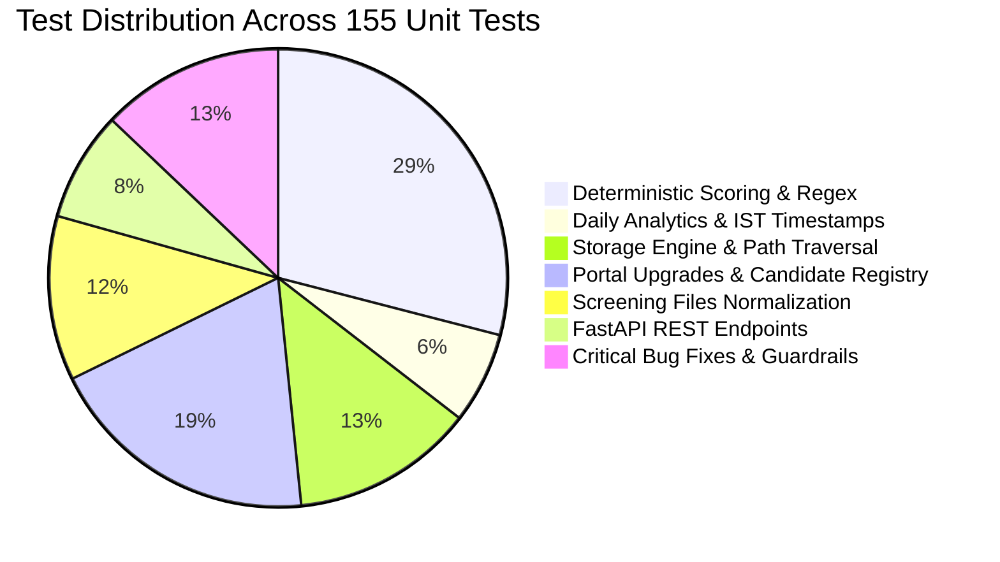

# 🧪 Testing Guide & Quality Assurance — FITMENT.AI

> **Audience**: QA Engineers, Developers, and Continuous Integration (CI) Maintainers.  
> **Last Reviewed**: 2026-10-19  
> **Test Suite Root**: [`tests/`](file:///e:/Projects/resume-screening-agent/tests).

---

## 1. Test Suite Architecture & Coverage

FITMENT.AI maintains a comprehensive automated regression suite comprising **155 test cases** across 9 specialized test modules. All tests execute using standard Python `unittest`, requiring no external testing plugins or cloud network connections.



---

## 2. Test Module Inventory

| Test Module | Test Count | Scope of Verification | Key Assertions |
| :--- | :--- | :--- | :--- |
| [`test_daily_analytics_navigation_timestamps.py`](file:///e:/Projects/resume-screening-agent/tests/test_daily_analytics_navigation_timestamps.py) | 10 | Daily analytics in IST, calendar-day boundary isolation, last-screened timestamps, pending navigation, and filter reset. | Zero count carryover across IST midnight; Candidate Tracker resets filters on "View All". |
| [`test_deterministic_engine.py`](file:///e:/Projects/resume-screening-agent/tests/test_deterministic_engine.py) | 45 | Candidate metadata extraction, seniority parsing, academic date filtering, certification checks, and weighted scoring. | Math formula precision; school graduation years (e.g. 2004) ignored in experience. |
| [`test_file_storage.py`](file:///e:/Projects/resume-screening-agent/tests/test_file_storage.py) | 20 | SHA-256 deduplication, atomic writes, collision-safe naming, and path-traversal prevention. | `PermissionError` raised on `../../` traversal; identical files reuse single disk copy. |
| [`test_portal_upgrades.py`](file:///e:/Projects/resume-screening-agent/tests/test_portal_upgrades.py) | 30 | 11 recruitment statuses, status history audit trails, follow-up scheduling, and portal-wide candidate searches. | Status changes write immutable audit rows; follow-up overdue dates alert properly. |
| [`test_screening_files_normalization.py`](file:///e:/Projects/resume-screening-agent/tests/test_screening_files_normalization.py) | 18 | Normalization of legacy screening file records (handling dict, list, string formats safely). | Eliminates `TypeError: string indices must be integers`. |
| [`test_api.py`](file:///e:/Projects/resume-screening-agent/tests/test_api.py) | 12 | FastAPI endpoints (`/screen`, `/candidates`, `/health`, `/screen/upload`). | Valid JSON schemas, HTTP status codes, and error formatting. |
| [`test_critical_fixes.py`](file:///e:/Projects/resume-screening-agent/tests/test_critical_fixes.py) | 20 | Secret shielding regex in chatbot, module reload safeguards, and widget state crash defense. | Queries requesting API keys blocked with security notices. |

---

## 3. Running Tests

### Execute Complete Regression Suite
```powershell
python -m unittest discover tests
```
- Expected Duration: ~25–30 seconds.
- Expected Result: `Ran 155 tests ... OK`.

### Run a Specific Test Module
```powershell
python -m unittest tests/test_daily_analytics_navigation_timestamps.py
python -m unittest tests/test_deterministic_engine.py
python -m unittest tests/test_file_storage.py
```

### Syntax & Compilation Verification
Verify that all core Python modules compile without syntax errors:
```powershell
python -m py_compile app.py registry.py deterministic_engine.py chatbot.py llm_manager.py storage.py parser.py api.py
```

---

## 4. Guidelines for Writing New Tests

When writing new tests for FITMENT.AI:
1. **Zero-PII Fixtures**: Never use real candidate names, real phone numbers, or real CVs. Use synthetic fixtures (e.g. `Test Candidate`, `+91-9999999999`, `test@example.com`).
2. **Isolated Database**: Always run database tests against in-memory SQLite (`:memory:`) or a temporary database file in a `tempfile.TemporaryDirectory()`, never against the production `data/fitment.db`.
3. **Timezone Awareness**: When testing timestamps, use `zoneinfo.ZoneInfo("Asia/Kolkata")` to prevent failures on international CI runners.
